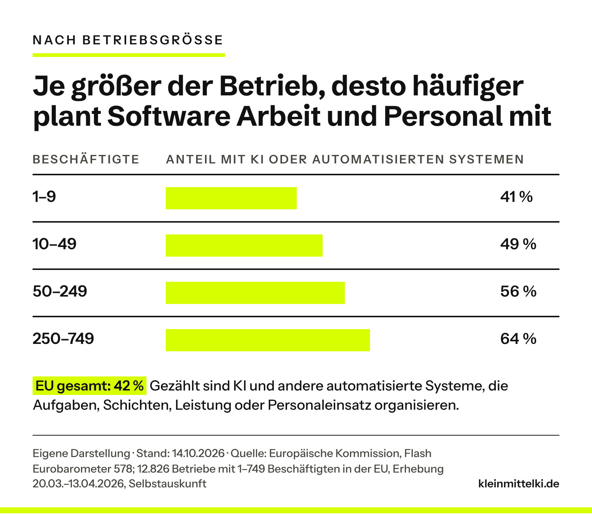

INTERN – vor Veröffentlichung entfernen: Thema ist Tills Idee (Mail vom 19.10.2026), der Mailtext stammt vermutlich aus ChatGPT. Deshalb ist der gesamte Abschnitt „Meine Einordnung“ ein Vorschlag der Redaktion. Er greift den Gedanken aus der Mail auf („Werkzeuge gibt es reichlich. Schwieriger ist es …“), ist aber nicht sicher von Till. Weitere Vorschlags-Sätze dort: „Wichtig ist zuerst …“, „Spannender finde ich die Hürden …“, „Auffällig ist …“, „Eine mögliche Erklärung …“. Ebenfalls Vorschlag: Beispiele im Mittelstand-Abschnitt (Handwerksbetrieb, Gastronomie, 20 bis 150 Leute sind redaktionell gewählt, nicht aus der Umfrage) und der Gedanke zum Mitnehmen. Bitte ersetzen oder freigeben. Titel von der Redaktion geändert, Till entscheidet bei der Freigabe: Die Mail-Headline „KI ist verfügbar …“ trägt die Umfrage nicht, weil sie Verfügbarkeit nicht abfragt; auch „Warum kleine Betriebe noch zögern“ (Entwurf 1) ist verworfen, weil kleine Betriebe die Hürden seltener nennen und gezählt KI oder automatisierte Systeme sind. Der neue Titel nennt die drei Hürden, die allen Betrieben vorgelegt wurden. Für den Prüfer: Die 42 Prozent sind keine reine KI-Quote (Frage nach „artificial intelligence or automated systems“ zur Organisation von Arbeit und Personal, mit oder ohne KI). Den Bericht konnte ich nur als gespiegeltes PDF lesen, die Eurobarometer-Seite selbst lädt nur per JavaScript. Die Gesamtzahlen (42, 12, 30, 21, 50/49/48, 90 Prozent, 12.826 Betriebe, Feldzeit) decken sich mit der Pressemitteilung IP/26/2160 und der offiziellen Infografik der GD Beschäftigung. Nur aus dem Spiegel-PDF (Prüfer, 19.10.2026: bei europa.eu nicht gefunden) stammen die Größenklassen-Werte 41/49/56/64 Prozent in der Grafik und die Aussage, dass größere Betriebe die Hürden häufiger nennen. Das PDF trägt Katalognummer und ISBN der Kommission; vor Veröffentlichung bitte auf der Eurobarometer-Seite im Browser gegenlesen. Deutschland-Wert ist im Bericht uneinheitlich (ein Drittel bzw. ein Viertel), deshalb ohne Zahl.

## Was ist passiert?

Die Europäische Kommission hat am 14. Oktober 2026 den Flash Eurobarometer 578 veröffentlicht. Befragt wurden vom 20. März bis 13. April 2026 Inhaber, Geschäftsführer, IT- und Personalverantwortliche aus 12.826 privaten Betrieben mit 1 bis 749 Beschäftigten in allen 27 EU-Staaten. Ergebnis: 42 Prozent nutzen KI oder automatisierte Systeme, um Arbeit und Personal zu organisieren. 12 Prozent tun das umfangreich, 30 Prozent begrenzt oder zum Ausprobieren. Weitere 21 Prozent planen es. Als wichtige Hürden nennen 50 Prozent hohe Investitionskosten, 49 Prozent rechtliche Unsicherheit und 48 Prozent fehlendes Fachwissen im Haus.

Was die Grafik zeigt: Je größer der Betrieb, desto häufiger sind solche Systeme im Einsatz, von 41 Prozent bei bis zu 9 Beschäftigten bis 64 Prozent bei 250 bis 749.

## Meine Einordnung

Wichtig ist zuerst, was gemessen wurde. Die 42 Prozent sind keine KI-Quote. Gezählt wurden digitale Systeme, die Aufgaben, Schichten, Leistung oder Personaleinsatz organisieren, mit oder ohne KI. Mit den [57 Prozent aus der Bitkom-Umfrage](https://www.kleinmittelki.de/ki-nutzung-unternehmen-bitkom-2026/) ist das nicht vergleichbar. Spannender finde ich die Hürden. Die drei häufigsten sind Kosten, Rechtsfragen und Wissen, keine davon ist eine Technikfrage. Werkzeuge gibt es reichlich. Schwieriger ist es, daraus einen sicheren und wirtschaftlich sinnvollen Ablauf zu machen. Auffällig ist: Größere Betriebe nennen diese Hürden meist häufiger als kleine, obwohl sie mehr nutzen. Eine mögliche Erklärung: Wer schon angefangen hat, sieht genauer, was dazugehört.

## Was bedeutet das für den Mittelstand?

Für einen Betrieb mit 20 bis 150 Leuten, etwa einen Handwerksbetrieb mit Einsatzplanung oder eine Gastronomie mit Schichtplan, sind das die drei Fragen vor jeder Anschaffung. Die Geschäftsführung kann sie einzeln beantworten: Was kostet das System im Jahr, samt Einrichtung? Welche Regeln gelten, wenn es Leistung misst oder Schichten verteilt? Dabei geht es um Daten der Beschäftigten. Und wer im Team betreut es? Die Umfrage zeigt auch: 90 Prozent der Nutzer lassen am Ende Menschen entscheiden. Das ist ein guter Maßstab für den Anfang. Dieser Beitrag ersetzt keine Rechtsberatung.

## Ein Gedanke zum Mitnehmen

Wenn Software morgen eure Schichten plant: Wer im Betrieb könnte erklären, warum sie so plant?

## Zum Originalartikel

:::bookmark https://europa.eu/eurobarometer/surveys/detail/3696 | Flash Eurobarometer 578: Workplace-related drivers and obstacles for the adoption of Artificial Intelligence and Algorithmic Management by SMEs and Mid-Caps | Europäische Kommission, Eurobarometer | Originalveröffentlichung vom 14.10.2026

:::bookmark https://ec.europa.eu/commission/presscorner/detail/de/ip_26_2160 | Eurobarometer-Umfrage zeigt zunehmende Nutzung von KI in europäischen Unternehmen | Europäische Kommission, Pressemitteilung IP/26/2160 | Originalveröffentlichung vom 14.10.2026
