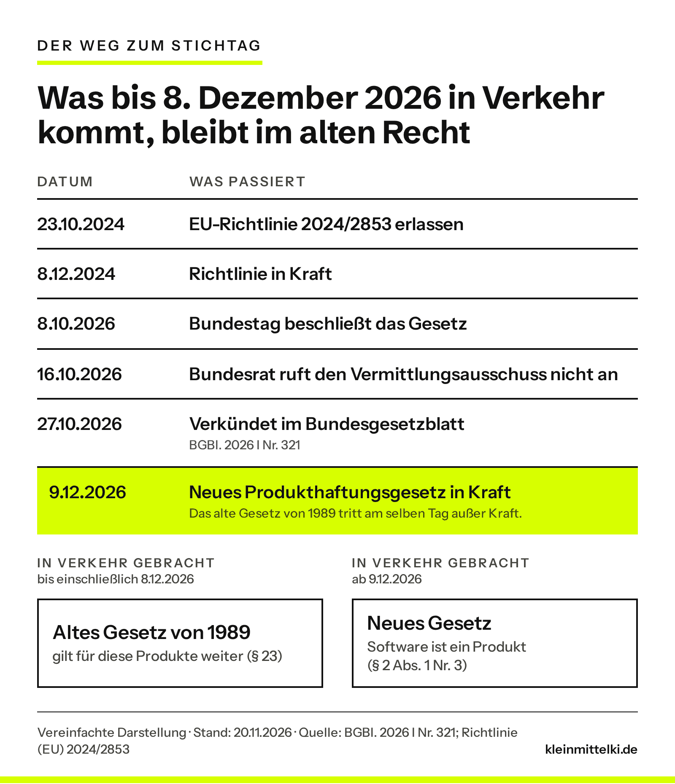

INTERN – vor Veröffentlichung entfernen: Till hat zu diesem Thema keine Einschätzung geliefert. Alles Folgende ist Vorschlag der Redaktion, bitte ersetzen oder freigeben: (1) Die Einstiegsszene (Maschinenbauer mit 60 Leuten, KI-Kamera, Fernwartungs-Update) ist ein ausgedachtes Beispiel, kein echter Fall; sie wird im Abschnitt zu Updates wieder aufgegriffen („Für den Maschinenbauer aus dem Einstieg …“). (2) Die vier Fälle unter „Wer betroffen ist“ (Maschinenbauer, Elektrobetrieb mit App, Softwarehaus, Betrieb mit eingebautem KI-Modell) sind Beispiele der Redaktion. (3) Auslegungen der Redaktion, die so nicht wörtlich im Gesetz stehen: „Eher nicht betroffen ist nach dem Wortlaut, wer …“ (abgeleitet aus § 3), „Für ein Softwarehaus mit reiner Bürosoftware … ist das Risiko … kleiner“ (abgeleitet aus § 1), der Grenzfall „großes Update an Altprodukt“ (Erwägungsgrund 40, § 23 schweigt) und der Hinweis zu Eigenentwicklungen (§ 6 Abs. 3). (4) Die Checkliste ist aus dem Gesetzestext zusammengestellt, keine Rechtsberatung. (5) Ich-Form, komplett Vorschlag: der Absatz ab „Ich lese das Gesetz weniger als neue Pflicht …“ in „Was das für den Mittelstand bedeutet“. Quellenstand 20.11.2026: Gesetz verkündet (BGBl. 2026 I Nr. 321 vom 27.10.2026), Richtlinie vollständig im amtlichen Text gelesen; Kanzlei- und IHK-Texte nur als Wegweiser, nicht zitiert. Länge rund 1.980 Wörter, am oberen Rand des Langtext-Rahmens (1.900–2.000); falls zu lang (deine Rückmeldung vom 25.10.: „generell viel zu lange“), lassen sich „Wenn es vor Gericht geht“ und die vier Fallbeispiele kürzen. Zwei Grafiken statt vier bis fünf.

Stell dir einen Maschinenbauer mit 60 Leuten vor, der Verpackungsmaschinen für Lebensmittelbetriebe baut. Die Steuerung ist eigene Software. Eine Kamera mit KI-Bilderkennung stoppt die Maschine, sobald eine Hand in den Gefahrenbereich greift. Updates spielt der Betrieb per Fernwartung auf. Im Frühjahr 2027 liefert er eine neue Maschine aus. Ein halbes Jahr später bringt ein Update einen Fehler in die Erkennung, und eine Mitarbeiterin des Kunden verletzt sich. Wer haftet, und wofür genau?

Ab dem 9. Dezember 2026 gibt es darauf eine neue Antwort. Dann gilt in Deutschland ein neues Produkthaftungsgesetz. Es setzt eine EU-Richtlinie um und nennt Software erstmals ausdrücklich als Produkt. Das Gesetz ist beschlossen und im Bundesgesetzblatt verkündet. Dieser Beitrag erklärt, was sich ändert, wen es trifft und was eine Geschäftsführung jetzt prüfen kann.

```html
<div class="kmk-kurz" style="border:2px solid #111;border-left:10px solid #D7FF00;padding:18px 22px;margin:28px 0;background:#fff;color:#111"><p style="margin:0 0 12px;font-weight:700;font-size:13px;letter-spacing:3px;text-transform:uppercase;line-height:1.3">Das Wichtigste in 30 Sekunden</p><ul style="margin:0;padding-left:20px;display:grid;gap:8px;line-height:1.5"><li style="margin:0">Ab dem 9. Dezember 2026 ist Software ausdrücklich ein Produkt, egal ob sie auf dem Gerät läuft, als App kommt oder aus der Cloud. KI-Systeme zählen dazu.</li><li style="margin:0">Betroffen sind vor allem Betriebe, die Software entwickeln, in eigene Produkte einbauen oder unter eigenem Namen anbieten. Wer Standard-Software nur nutzt, ist nach dem Wortlaut nicht Hersteller.</li><li style="margin:0">Die Verantwortung endet nicht mit der Auslieferung: Solange du Updates liefern kannst, zählen fehlerhafte Updates und fehlende Sicherheitsupdates mit.</li><li style="margin:0">Für Produkte, die bis einschließlich 8. Dezember 2026 in Verkehr gebracht wurden, gilt das alte Gesetz weiter.</li><li style="margin:0">Jetzt sinnvoll: Produkte mit Software auflisten, Update-Wege klären, Verträge mit Zulieferern und die Versicherung prüfen lassen.</li></ul></div>
```

## Was sich am 9. Dezember ändert

Grundlage ist die [EU-Richtlinie 2024/2853](https://eur-lex.europa.eu/eli/dir/2024/2853/oj/deu) über die Haftung für fehlerhafte Produkte vom 23. Oktober 2024. Die Mitgliedstaaten mussten sie bis zum 9. Dezember 2026 umsetzen (Art. 22). Deutschland hat das mit dem [Gesetz zur Modernisierung des Produkthaftungsrechts](https://www.recht.bund.de/eli/bund/bgbl-1/2026/321) getan. Der Bundestag hat es am 8. Oktober 2026 beschlossen, der Bundesrat hat am 16. Oktober darauf verzichtet, den Vermittlungsausschuss anzurufen. Verkündet wurde es am 27. Oktober 2026 im Bundesgesetzblatt (BGBl. 2026 I Nr. 321). Das neue Produkthaftungsgesetz tritt am 9. Dezember 2026 in Kraft, das alte von 1989 am selben Tag außer Kraft.

Produkthaftung heißt: Der Hersteller haftet für Schäden durch ein fehlerhaftes Produkt, ohne dass ihm ein Verschulden nachgewiesen werden muss. Die Richtlinie nennt das verschuldensunabhängige Haftung (Erwägungsgrund 6). Fehlerhaft ist ein Produkt, wenn es nicht die Sicherheit bietet, die vorgeschrieben ist oder die man erwarten darf (§ 7). Drei Änderungen sind für Betriebe mit Software besonders wichtig.

**Software ist ein Produkt.** Das alte Gesetz sprach von beweglichen Sachen und Elektrizität. Das neue nennt Software ausdrücklich (§ 2 Abs. 1 Nr. 3). Laut Richtlinie gilt das unabhängig davon, ob die Software auf einem Gerät gespeichert ist, aus der Cloud abgerufen oder als Software-as-a-Service bereitgestellt wird. Als Beispiele nennt sie Betriebssysteme, Firmware, Anwendungen und KI-Systeme (Erwägungsgrund 13). Das Wort „KI“ selbst steht im deutschen Gesetz nicht.

**Lernende Systeme zählen mit.** Bei der Frage, ob ein Produkt fehlerhaft ist, wird ausdrücklich berücksichtigt, dass es nach der Auslieferung weiterlernen oder neue Funktionen erwerben kann (§ 7 Nr. 3). Auch Anforderungen an die Cybersicherheit gehören zur Sicherheit (§ 7 Nr. 5).

**Keine Obergrenze, keine Selbstbeteiligung mehr.** Bisher war die Haftung für Personenschäden auf 85 Millionen Euro begrenzt, und bei Sachschäden trug der Geschädigte die ersten 500 Euro selbst (§§ 10 und 11 des alten Gesetzes). Beides fehlt im neuen Gesetz. Die Richtlinie schließt finanzielle Obergrenzen ausdrücklich aus (Erwägungsgrund 56).

Ausgenommen ist freie und Open-Source-Software, die außerhalb einer Geschäftstätigkeit entwickelt oder bereitgestellt wird (§ 2 Abs. 1 Nr. 3). Die Ausnahme schützt die Entwickler solcher Software, nicht den Betrieb, der sie einbaut. Wer eine solche Bibliothek in sein Produkt integriert, haftet für sein Produkt selbst (§ 4 Abs. 1, Erwägungsgrund 15).

## Wer betroffen ist und wer eher nicht

Haften muss in erster Linie der **Hersteller**: wer ein Produkt selbst entwickelt oder herstellt, es entwerfen oder herstellen lässt oder seinen Namen oder seine Marke daraufsetzt (§ 3). Dazu kommen die Hersteller von Komponenten. Baut ein Betrieb eine fremde Komponente ein und verursacht diese den Fehler, haften beide (§ 4 Abs. 1), und zwar als Gesamtschuldner (§ 15). Komponente kann auch Software sein oder ein digitaler Dienst, ohne den das Produkt eine Funktion nicht ausführen kann (§ 4 Abs. 2). Sitzt der Hersteller außerhalb der EU, haften Importeur und Beauftragter wie der Hersteller (§ 10).

Was das im Mittelstand heißen kann, zeigen vier typische Fälle:

- **Maschinen- und Anlagenbauer** mit eigener Steuerungssoftware, Fernwartung oder Bedien-App. Hier liegt das Thema am nächsten, weil ein Fehler Menschen verletzen kann.
- **Ein Elektrobetrieb mit 25 Leuten**, der für seine Kunden eine eigene App zur Steuerung von Heizung und Rollläden programmiert hat. Die App ist ein Produkt, der Betrieb ihr Hersteller.
- **Ein Softwarehaus mit 10 bis 50 Beschäftigten**, das Anwendungen unter eigenem Namen verkauft oder als Cloud-Dienst vermietet.
- **Ein Betrieb, der ein KI-Modell eines großen Anbieters in sein eigenes Produkt einbaut**, etwa als Funktion einer Maschine oder einer Kunden-App. Das Modell ist dann eine Komponente. Im Bild aus dem Beitrag [ChatGPT ist nicht das KI-Modell](https://www.kleinmittelki.de/chatgpt-claude-gemini-ki-modelle-erklaert/): Wer einen fremden Motor in sein Fahrzeug baut, steht gegenüber Geschädigten für das ganze Fahrzeug ein.

Wichtig für die Einordnung: Das Gesetz schützt **natürliche Personen**. Ersetzt werden Schäden an Leben, Körper und Gesundheit, an Sachen und an Daten, außer an Sachen, die ausschließlich beruflich genutzt werden, und an Daten, die beruflich genutzt werden (§ 1 Abs. 1). Für ein Softwarehaus mit reiner Bürosoftware für Firmenkunden ist das Risiko aus diesem Gesetz deshalb kleiner als für einen Maschinenbauer. Verletzt sich aber ein Mensch, zählt das immer, auch wenn er bei einem Firmenkunden arbeitet. Die Haftung aus Verträgen bleibt ohnehin bestehen (§ 21 Abs. 2).

**Eher nicht betroffen** ist nach dem Wortlaut, wer gekaufte Standard-Software oder einen KI-Dienst nur im eigenen Betrieb nutzt, etwa Microsoft 365 oder ChatGPT im Büro. Wer nichts entwickelt und nichts herstellen lässt, ist nach § 3 nicht Hersteller. Zwei Ausnahmen solltest du kennen. Wer ein Produkt ohne Einverständnis des Herstellers wesentlich verändert und es dann weitergibt oder in Betrieb nimmt, wird selbst Hersteller des veränderten Produkts (§ 5). Und eigene Entwicklungen, die nur im Betrieb laufen, sind nicht automatisch außen vor: Das Gesetz kennt auch die „Inbetriebnahme“ eines Produkts, das nie verkauft oder weitergegeben wurde (§ 6 Abs. 3). Wann das greift, ist eine Frage für deine Anwältin oder deinen Anwalt.

Für falsche Auskünfte eines Website-Chatbots gibt es schon andere Haftungswege. Das OLG Hamm hat sie im Mai 2026 als irreführende geschäftliche Handlung gewertet, siehe [Wenn der Chatbot sich irrt, haftet der Betrieb](https://www.kleinmittelki.de/olg-hamm-chatbot-haftung/). Die Richtlinie stellt dazu klar, dass Informationen als solche kein Produkt sind (Erwägungsgrund 13). Und die Pflichten aus dem AI Act gelten unabhängig davon weiter, siehe [Muss ich KI-Bilder jetzt kennzeichnen?](https://www.kleinmittelki.de/ai-act-ki-bilder-kennzeichnen/)

```html
<style>.kmk-check__list{margin:18px 0 12px;border-top:1px solid rgba(17,17,17,.14)}.kmk-check__row{display:grid;grid-template-columns:1fr auto;gap:8px 24px;align-items:center;padding:14px 0;border-bottom:1px solid rgba(17,17,17,.14)}.kmk-check__case{margin:0!important;font-size:15.5px!important;line-height:1.35;font-weight:600}.kmk-check__note{display:block;font-weight:400;font-size:13.5px;line-height:1.4;color:var(--c-muted,#5c5c56);margin-top:3px}.kmk-check__badge{font-weight:600;font-size:11px;line-height:1;letter-spacing:.12em;text-transform:uppercase;padding:8px 11px;white-space:nowrap;justify-self:end}.kmk-check__badge--no{background:#E8E7E1;color:#45453F}.kmk-check__badge--check{background:#fff;color:#111;box-shadow:inset 0 0 0 1.5px #111}.kmk-check__badge--yes{background:#111;color:var(--c-accent,#D7FF00)}@media(max-width:640px){.kmk-check__row{grid-template-columns:1fr}.kmk-check__badge{justify-self:start}}</style>
<figure class="kmk-chart kmk-check"><p class="kmk-chart__kicker">Grafik 01 / Bin ich Hersteller?</p><p class="kmk-chart__title">Wer Software entwickelt oder einbaut, ist betroffen. Wer sie nur nutzt, eher nicht.</p><p class="kmk-chart__sub">Orientierung nach dem neuen Produkthaftungsgesetz, gilt ab 9.&nbsp;Dezember&nbsp;2026</p><div class="kmk-check__list"><div class="kmk-check__row"><p class="kmk-check__case">Du entwickelst Software, eine App oder Firmware und bringst sie in Verkehr<span class="kmk-check__note">Wer ein Produkt selbst entwickelt oder herstellt, ist Hersteller. Software ist ein Produkt (§&nbsp;3, §&nbsp;2&nbsp;Abs.&nbsp;1&nbsp;Nr.&nbsp;3)</span></p><span class="kmk-check__badge kmk-check__badge--yes">Betroffen</span></div><div class="kmk-check__row"><p class="kmk-check__case">Du baust fremde Software oder ein KI-Modell als Komponente in dein eigenes Produkt ein<span class="kmk-check__note">Verursacht die Komponente den Fehler, haften beide: du und ihr Hersteller (§&nbsp;4&nbsp;Abs.&nbsp;1)</span></p><span class="kmk-check__badge kmk-check__badge--yes">Betroffen</span></div><div class="kmk-check__row"><p class="kmk-check__case">Du veränderst ein Produkt wesentlich ohne Einverständnis des Herstellers und gibst es weiter<span class="kmk-check__note">Du wirst selbst Hersteller des veränderten Produkts (§&nbsp;5)</span></p><span class="kmk-check__badge kmk-check__badge--yes">Betroffen</span></div><div class="kmk-check__row"><p class="kmk-check__case">Du bringst Produkte eines Herstellers außerhalb der EU in Verkehr<span class="kmk-check__note">Importeur und Beauftragter haften wie der Hersteller (§&nbsp;10)</span></p><span class="kmk-check__badge kmk-check__badge--yes">Betroffen</span></div><div class="kmk-check__row"><p class="kmk-check__case">Eigene Software, die nur im eigenen Betrieb läuft<span class="kmk-check__note">Das Gesetz kennt auch die Inbetriebnahme eines Produkts, das nie verkauft oder weitergegeben wurde (§&nbsp;6&nbsp;Abs.&nbsp;3)</span></p><span class="kmk-check__badge kmk-check__badge--check">Klären lassen</span></div><div class="kmk-check__row"><p class="kmk-check__case">Großes Update an einem Produkt, das bis einschließlich 8.12.2026 ausgeliefert wurde<span class="kmk-check__note">Laut Richtlinie gilt ein wesentlich verändertes Produkt als neu bereitgestellt (Erwägungsgrund&nbsp;40). §&nbsp;23 regelt das nicht ausdrücklich</span></p><span class="kmk-check__badge kmk-check__badge--check">Klären lassen</span></div><div class="kmk-check__row"><p class="kmk-check__case">Du nutzt gekaufte Standard-Software oder einen KI-Dienst nur im eigenen Betrieb, etwa Microsoft 365 oder ChatGPT im Büro<span class="kmk-check__note">Einordnung der Redaktion: Wer nichts entwickelt und nichts herstellen lässt, ist nach §&nbsp;3 nicht Hersteller</span></p><span class="kmk-check__badge kmk-check__badge--no">Eher nicht</span></div></div><figcaption>Vereinfachte Darstellung, keine Rechtsberatung. Was für deine Produkte gilt, hängt vom Einzelfall ab. Stand: 20.11.2026. Quelle: Produkthaftungsgesetz, BGBl. 2026 I Nr. 321; Richtlinie (EU) 2024/2853.</figcaption></figure>
```

## Updates: Die Verantwortung endet nicht an der Laderampe

Grundsätzlich kommt es darauf an, wie ein Produkt war, als es in Verkehr gebracht wurde (§ 8 Abs. 1). Bei Software reicht die Verantwortung weiter. Solange ein Hersteller Updates selbst liefern oder durch Dritte liefern lassen kann, behält er die **Kontrolle** über das Produkt (§ 8 Abs. 2). Maßgeblich ist dann der Zeitpunkt, an dem das Produkt seine Kontrolle verlassen hat.

Die Folge steht in § 9 Abs. 2. Der Hersteller kann sich nicht damit entlasten, der Fehler sei bei der Auslieferung noch nicht da gewesen, wenn der Fehler zurückgeht auf

- die Software selbst, einschließlich Updates und Upgrades,
- einen verbundenen digitalen Dienst,
- fehlende Software-Updates, die zur Aufrechterhaltung der Sicherheit erforderlich sind, oder
- eine wesentliche Änderung des Produkts.

Zwei Grenzen nennt die Richtlinie selbst. Sie verpflichtet nicht dazu, überhaupt Updates anzubieten. Und installiert der Eigentümer ein bereitgestelltes Sicherheitsupdate nicht, liegt das außerhalb der Kontrolle des Herstellers (Erwägungsgrund 51). Ein Produkt ist auch nicht schon deshalb fehlerhaft, weil es inzwischen ein besseres Update gibt (§ 8 Abs. 3).

Für den Maschinenbauer aus dem Einstieg heißt das: Das fehlerhafte Fernwartungs-Update fällt in seine Verantwortung, auch wenn die Maschine bei der Auslieferung einwandfrei war. Hätte er ein Sicherheitsupdate bereitgestellt und der Kunde es nicht eingespielt, sähe es anders aus. Genau deshalb lohnt es sich festzuhalten, welches Update wann an wen ging.

## Was für Produkte gilt, die schon verkauft sind

Für alles, was bis einschließlich 8. Dezember 2026 in Verkehr gebracht oder in Betrieb genommen wurde, gilt das alte Produkthaftungsgesetz weiter (§ 23). Die Maschine, die im Sommer 2026 ausgeliefert wurde, fällt also unter altes Recht.



Offen ist ein Grenzfall: das große Update nach dem Stichtag. Laut Richtlinie gilt ein wesentlich verändertes Produkt als zum Zeitpunkt der Änderung neu bereitgestellt. Das kann durch ein Software-Update geschehen oder durch das Weiterlernen eines KI-Systems (Erwägungsgrund 40). Ob ein solches Update ein Altprodukt ins neue Recht holt, regelt § 23 nicht ausdrücklich. Wer im kommenden Jahr größere Funktions-Updates für ausgelieferte Produkte plant, sollte diese Frage vorher klären lassen.

## Wenn es vor Gericht geht

Bei Software ist es für Geschädigte oft schwer zu beweisen, was schiefgelaufen ist. Das Gesetz gleicht das aus. Macht die geschädigte Person ihren Anspruch plausibel, ordnet das Gericht auf ihren Antrag an, dass der Hersteller relevante Beweismittel offenlegt, mit Schutz für Geschäftsgeheimnisse (§ 19). Legt er sie trotz Anordnung nicht offen, wird der Fehler vermutet. Vermutet wird er auch bei einer offensichtlichen Funktionsstörung im normalen Gebrauch (§ 20 Abs. 1). Ist ein Fall technisch so komplex, dass der Beweis übermäßig schwierig ist, kann es reichen, dass der Fehler wahrscheinlich ist (§ 20 Abs. 3).

Für einen Betrieb heißt das: Unterlagen über Entwicklung, Tests und Updates sind nicht nur Ordnung. Im Streitfall sind sie das wichtigste Werkzeug.

Zu den Fristen: Ansprüche verjähren in drei Jahren, gerechnet ab dem Zeitpunkt, an dem der Geschädigte von Fehler, Schaden und Hersteller weiß oder hätte wissen müssen (§ 16). Sie erlöschen spätestens zehn Jahre nach dem Inverkehrbringen, bei wesentlich veränderten Produkten zehn Jahre nach der Änderung (§ 17). Bei Gesundheitsschäden, die erst spät erkennbar werden, sind es 25 Jahre.

## Was du jetzt prüfen kannst

Eine Liste für die Geschäftsführung, am besten zusammen mit der Technikleitung. Sie ersetzt keine Rechtsberatung, bereitet aber das Gespräch mit Anwalt und Versicherer vor.

1. **Produktliste mit Software.** Welche eurer Produkte enthalten Software, Firmware, eine App, einen Cloud-Dienst oder eine KI-Funktion? Wer hat sie entwickelt: ihr selbst, ein Zulieferer, ein Anbieter außerhalb der EU?
2. **Stichtag festhalten.** Welche Produkte bringt ihr bis einschließlich 8. Dezember 2026 in Verkehr, welche danach? Ist das Auslieferungsdatum für jedes Gerät dokumentiert?
3. **Update-Wege klären.** Wer kann Updates aufspielen? Wie erfahren Kunden von Sicherheitsupdates? Wird festgehalten, wann welches Update bereitgestellt wurde?
4. **Verträge mit Zulieferern.** Ihr haftet gegenüber Geschädigten auch für fremde Komponenten. Wie ist der Rückgriff auf Zulieferer von Software und KI-Funktionen geregelt? Gegenüber Geschädigten lässt sich die Haftung vertraglich nicht ausschließen (§ 18). Die Richtlinie erlaubt aber, dass ein Hersteller mit einem kleinen Softwarezulieferer vereinbart, auf den Rückgriff zu verzichten (Art. 12 Abs. 2). Liefert dein Betrieb selbst Software zu, ist das ein Punkt für die nächste Vertragsverhandlung.
5. **Versicherung prüfen lassen.** Deckt eure Betriebs- oder Produkthaftpflicht Schäden durch Software, Updates und Cloud-Dienste? Diese Frage gehört an den Versicherer oder Makler.
6. **Unterlagen ablegen.** Entwicklung, Tests, Risikobewertung und Update-Historie so aufbewahren, dass ihr sie zehn Jahre später noch vorlegen könnt.

## Was das für den Mittelstand bedeutet

Für die meisten Betriebe, die Software und KI nur nutzen, ändert dieses Gesetz wenig. Für Betriebe, die Software in ihre Produkte bauen oder selbst Software anbieten, ändert es viel: Die Verantwortung reicht künftig so weit wie der Update-Kanal. Das gilt für den Maschinenbauer mit Fernwartung genauso wie für das Softwarehaus mit Cloud-Angebot oder den Elektrobetrieb mit eigener App.

Ich lese das Gesetz weniger als neue Pflicht, sondern als Anpassung an die Wirklichkeit. Viele Produkte werden heute nach dem Verkauf weiter verändert. Wer Updates liefern kann, soll auch für sie einstehen. Die gut zwei Wochen bis zum Stichtag reichen nicht für alles. Für eine Produktliste und einen Termin mit dem Versicherer reichen sie.

Dieser Beitrag ersetzt keine Rechtsberatung. Was für deine Produkte konkret gilt, klärst du mit deiner Anwältin oder deinem Anwalt und deinem Versicherer.

## Ein Gedanke zum Mitnehmen

Wenn morgen ein Update für eines deiner Produkte rausgeht: Wüsstest du, wer es freigegeben hat und wo das steht?

## Quellen

Abgerufen am 20.11.2026, zuletzt geprüft am 20.11.2026

- [Gesetz zur Modernisierung des Produkthaftungsrechts und zur Änderung weiterer Vorschriften vom 22.10.2026, BGBl. 2026 I Nr. 321 (verkündet am 27.10.2026)](https://www.recht.bund.de/eli/bund/bgbl-1/2026/321)
- [Richtlinie (EU) 2024/2853 des Europäischen Parlaments und des Rates vom 23.10.2024 über die Haftung für fehlerhafte Produkte, ABl. L, 2024/2853 (18.11.2024)](https://eur-lex.europa.eu/eli/dir/2024/2853/oj/deu)
- [Bundesrat, Drucksache 584/26: Gesetzesbeschluss des Deutschen Bundestages (09.10.2026)](https://dserver.bundestag.de/brd/2026/0584-26.pdf)
- [Bundesrat, Drucksache 584/26 (Beschluss) vom 16.10.2026](https://dserver.bundestag.de/brd/2026/0584-26B.pdf)
- [Produkthaftungsgesetz von 1989 in der bis 8.12.2026 geltenden Fassung, §§ 2, 10 und 11 (Bundesministerium der Justiz, gesetze-im-internet.de)](https://www.gesetze-im-internet.de/prodhaftg/)
