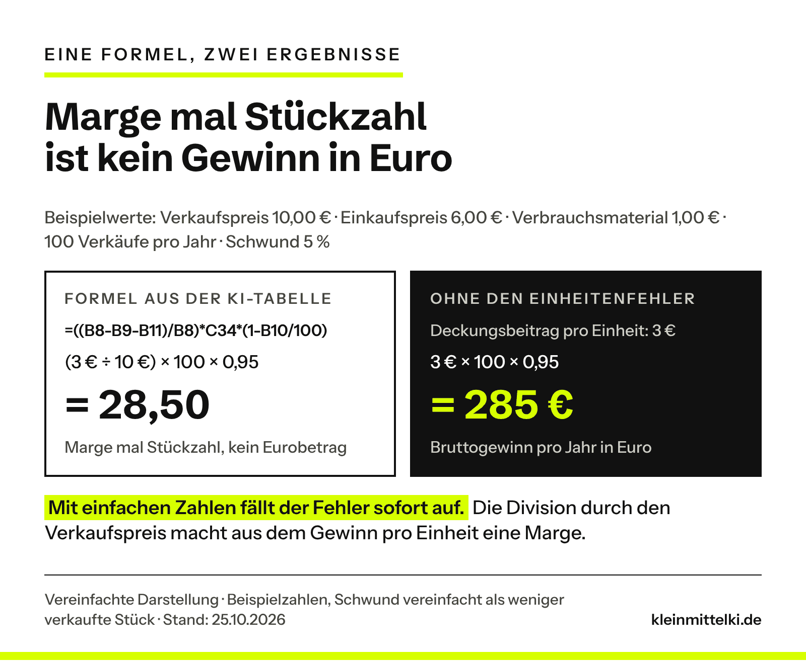
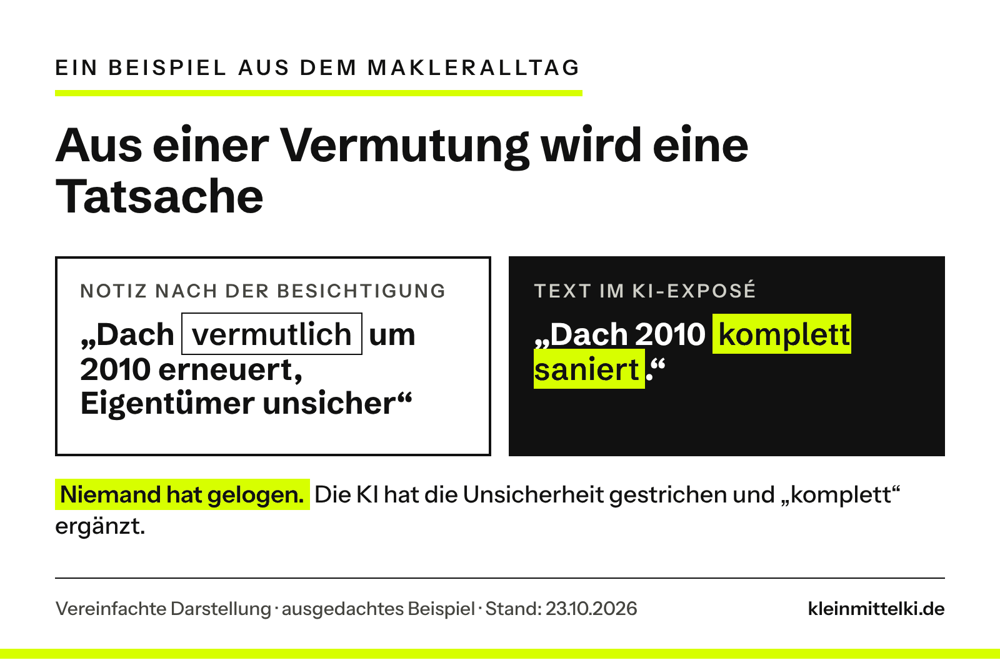

INTERN – vor Veröffentlichung entfernen: Überarbeitet mit Tills drei eigenen Fällen (Chat 23.10.2026). Alles in Ich-Form stammt aus Tills Text, sprachlich geglättet und gekürzt; abgeschwächt wurden nur Steigerungen („unglaublich nützlich“ → „sehr nützlich“, „begeistert“ und „enorm“ gestrichen) und das Handelsbeispiel aus deinem Text gestrichen (Regel 4). Bitte prüfen: (1) Steckachse – der Text sagt nur, dass für die „100 %“ Angaben fehlten, nicht dass die Achse nicht gepasst hat. (2) Redaktionell formuliert (nicht Ich-Form, aber bitte gegenlesen): Einleitungsabsatz 2, der Gedanke zum Mitnehmen, die Schritte in „Zum Ausprobieren“ und die Überschrift des Prompt-Kastens („Mein Zusatz für technische Fragen“). (3) Ausgedacht und im Text so gekennzeichnet: nur noch Exposé und Speisekarte (zeigen Vermutung → Tatsache bzw. Sicherheitsangaben, was deine Fälle nicht zeigen); Malerbetrieb und Hausverwaltung sind entfallen. (4) LinkedIn-Beitrag von Alex Lichtenberger: nach deinem Text als Anstoß genannt, aber nicht verlinkt (Redaktion konnte ihn nicht lesen) – Link bitte selbst ergänzen oder so lassen. (5) OLG-Hamm-Beitrag (olg-hamm-chatbot-haftung) verlinken, sobald er online ist: Abschnitt „Das eigentliche Risiko …“, Satz „Was ein Chatbot auf der Website …“. Titel-Alternative aus deinem Text: „ChatGPT lag falsch. Und war sich trotzdem sicher.“ Grafiken: fünf Schaubilder eingebunden; neu g4 (Excel-Rechnung 28,50 vs. 285 €), g5 an die neuen Regeln 3 und 4 angepasst.

Die Excel-Datei, die ChatGPT mir für ein Geschäftsmodell gebaut hatte, sah professionell aus: saubere Tabellen, Eingabefelder, automatisch berechnete Kennzahlen. Alles wirkte durchdacht. Nur: Einige Berechnungen stimmten nicht. Ohne meine eigene Kontrolle hätte ich die Fehler möglicherweise übersehen.

Genau das ist das Tückische: KI liegt nicht nur manchmal falsch. Sie liegt falsch und klingt dabei genauso sicher wie bei richtigen Antworten. Den Anstoß, die eigenen Erfahrungen genauer anzusehen, gab ein LinkedIn-Beitrag von Alex Lichtenberger. Hier geht es um die Frage, die daraus folgt: **Wie setzt ein Betrieb KI sinnvoll ein, wenn er sich nicht auf jede Antwort verlassen kann?**

```html
<div class="kmk-kurz" style="border:2px solid #111;border-left:10px solid #D7FF00;padding:18px 22px;margin:28px 0;background:#fff;color:#111"><p style="margin:0 0 12px;font-weight:700;font-size:13px;letter-spacing:3px;text-transform:uppercase;line-height:1.3">Das Wichtigste in 30 Sekunden</p><ul style="margin:0;padding-left:20px;display:grid;gap:8px;line-height:1.5"><li style="margin:0">KI liegt manchmal falsch und klingt dabei genauso sicher wie bei richtigen Antworten.</li><li style="margin:0">Drei eigene Fälle zeigen typische Muster: Sicherheit trotz fehlender Angaben, eine falsche Formel, eine Selbstprüfung ohne Beweiskraft.</li><li style="margin:0">Nicht jede Antwort braucht dieselbe Kontrolle. Entscheidend ist, was ein unbemerkter Fehler anrichten würde.</li><li style="margin:0">Drei Stufen helfen: frei nutzen, gezielt prüfen, nur mit Freigabe.</li><li style="margin:0">Bei Kalkulationen hilft ein einfacher Test: eine zentrale Formel mit wenigen, leicht nachvollziehbaren Zahlen nachrechnen.</li></ul></div>
```

## Warum KI so überzeugend danebenliegen kann

Der Fachbegriff dafür ist **Halluzination**. OpenAI beschreibt das in einem Forschungsbeitrag vom September 2025 als plausible, aber falsche Aussagen, die ein Sprachmodell erzeugt.

Wie das aussieht, zeigt OpenAI an einem eigenen Mitautor. Fragt man einen verbreiteten Chatbot nach dem Titel seiner Doktorarbeit, nennt er drei verschiedene Titel. Keiner davon stimmt. Beim Geburtstag passiert dasselbe.

Sprachmodelle werden so trainiert und bewertet, dass Raten sich mehr lohnt als ein ehrliches „Ich weiß es nicht“. OpenAI vergleicht das mit einem Test: Wer den Geburtstag einer Person nicht kennt und rät, liegt immerhin mit einer Chance von 1 zu 365 richtig. Wer „weiß ich nicht“ schreibt, bekommt sicher null Punkte. Also rät das Modell.

Wichtig ist auch, was OpenAI daraus folgert: Fehlerfrei werden Sprachmodelle nie, weil manche Fragen sich schlicht nicht beantworten lassen. Unvermeidbar sind Halluzinationen aber auch nicht, denn ein Modell kann sich bei Unsicherheit zurückhalten. Darauf hast du als Anwender keinen Einfluss. Auf deinen eigenen Ablauf schon.


Auch die Hilfeseite von OpenAI zu ChatGPT sagt ausdrücklich, dass ChatGPT sicher klingen kann, auch wenn es falschliegt. Als typische Fehler nennt sie falsche Daten und Fakten sowie erfundene Zitate, Studien und Verweise auf Quellen, die es nicht gibt. Die Empfehlung des Herstellers selbst: ChatGPT als ersten Entwurf nutzen, nicht als endgültige Quelle.

Nicht jeder Fehler ist dabei eine Halluzination. Eine falsch zugeordnete Excel-Zelle kann auch ein Logikfehler sein. Für dich macht das wenig Unterschied: **Eine KI-Antwort ist ein Vorschlag, kein Ergebnis.**

## Drei eigene Fälle: sicher im Ton, falsch in der Sache

In den vergangenen Monaten habe ich mehrfach erlebt, dass ChatGPT etwas mit großer Sicherheit behauptet hat, obwohl wichtige Informationen fehlten oder eine Berechnung schlicht nicht stimmte.

### Fall 1: Eine Steckachse und angeblich 100 Prozent Sicherheit

Für einen Fahrradanhänger an meinem Mountainbike brauchte ich eine passende Steckachse. ChatGPT empfahl ein Modell, mit Gewindesteigung, Achslänge und Zubehör, und war sich irgendwann „100 %“ sicher, dass es passt.

Für diese Sicherheit fehlten entscheidende Informationen. ChatGPT hatte aus der Hinterrad-Einbaubreite von 148 Millimetern auf die Achse geschlossen. Die Einbaubreite einer Nabe ist aber nicht dasselbe wie die nötige Steckachsenlänge, und die Gewindesteigung war nicht überprüft. Auf Nachfrage blieb es zunächst trotzdem dabei. Erst später räumte ChatGPT ein, dass man für eine verlässliche Aussage die Originalachse genauer prüfen müsste.

ChatGPT hatte nicht alle nötigen Informationen, aber trotzdem eine eindeutige Antwort. Für einen Handwerksbetrieb wird das relevant, wenn die KI ein Ersatzteil oder Material empfiehlt. Eine plausible Produktempfehlung ersetzt keine geprüften Spezifikationen und erst recht keine Herstellerfreigabe.

### Fall 2: Eine professionelle Excel-Kalkulation mit falscher Rechnung

Diesen Fall finde ich für kleine Betriebe besonders interessant. Es ging um genau das, was auch eine Bäckerei oder ein Gastronom regelmäßig kalkuliert: Preise, Verbrauchsmaterial, Schwund, Umsatz und Rentabilität.

Der erste Fehler: ChatGPT verwechselte wiederholt die Zellen für den Schwund in Prozent und das Verbrauchsmaterial in Euro. Fünf Prozent Schwund müssen anders behandelt werden als zehn Cent Material pro Einheit. Wer das vertauscht, verändert die ganze Kalkulationslogik.

Der zweite Fehler steckte in der Formel für den jährlichen Bruttogewinn:

```html
<div class="kmk-errors"><p class="kmk-errors__head">Die Formel aus der KI-Tabelle</p><p><strong>=((B8-B9-B11)/B8)*C34*(1-B10/100)</strong></p><p>B8: Verkaufspreis pro Einheit · B9: Einkaufspreis pro Einheit · B10: Schwund in Prozent · B11: Verbrauchsmaterial pro Einheit · C34: Anzahl der Verkäufe pro Jahr</p></div>
```

Fällt dir der Fehler auf?

Die Division durch den Verkaufspreis macht aus dem Gewinn pro Einheit eine Marge. Die wurde dann aber nicht mit einem Umsatz in Euro, sondern mit der Stückzahl multipliziert. Eine Prozentmarge mal Stückzahl ergibt keinen Bruttogewinn in Euro.

Mit einfachen Beispielzahlen statt der Originaldaten: Verkaufspreis 10,00 €, Einkaufspreis 6,00 €, Verbrauchsmaterial 1,00 €, 100 Verkäufe im Jahr, 5 % Schwund. Der Deckungsbeitrag pro Einheit liegt bei 3 Euro. Wirkt der Schwund vereinfacht als Minderung der Absatzmenge, ergibt sich 3 € × 100 × 0,95 = 285 €. Die fehlerhafte Formel liefert nur 28,50. Das ersetzt keine vollständige Schwundkalkulation, zeigt aber den Unterschied.



Dazu kam das Wachstum. Es sollte sich jeweils auf das Vorjahr beziehen: Bei 100.000 Euro Umsatz und zehn Prozent pro Jahr sind das 110.000 Euro im zweiten und 121.000 Euro im dritten Jahr, nicht 120.000 Euro. Das musste ich ausdrücklich korrigieren lassen.

### Fall 3: Kann ChatGPT seine eigenen Fehler erkennen?

Danach fragte ich ChatGPT sinngemäß: „Kannst du unsere bisherigen Chats analysieren und herausfinden, wo du falsche Informationen geliefert hast oder ich dich korrigieren musste?“ Die Antwort war hilfreich: ChatGPT fand unter anderem die Excel-Kalkulation und die Steckachse.

Aber woher weiß ich, ob dieses Audit selbst vollständig und richtig ist? ChatGPT konnte nicht garantieren, dass ihm alle früheren Gespräche und Anhänge zur Verfügung standen. Und ich musste trennen, was sich an Gesprächsstellen belegen ließ und was nur Interpretation war. Auch die Kontrolle musste ich also wieder hinterfragen. KI kann Unstimmigkeiten aufdecken und Formeln hinterfragen. Eine Selbstprüfung ist aber kein unabhängiger Beweis, dass alles stimmt.

## Das eigentliche Risiko: Niemand schaut mehr hin

Das OWASP-Projekt, eine gemeinnützige Gemeinschaft für IT-Sicherheit, führt Fehlinformation durch Sprachmodelle in seiner Liste der zehn wichtigsten Risiken für Anwendungen mit Sprachmodellen (Stand 2025). Als Ursache nennt es neben den Halluzinationen ausdrücklich das übermäßige Vertrauen: Menschen prüfen die Ausgaben nicht genug und übernehmen falsche Angaben in Entscheidungen und Abläufe. Erst dadurch wird aus einem Fehler ein Schaden. Als mögliche Folgen nennt OWASP Reputationsschäden und rechtliche Haftung.

Fall 2 zeigt, warum das so leicht passiert: Je professioneller ein Ergebnis aussieht, desto fertiger wirkt es. Auch im [Protokoll-Selbstversuch](https://www.kleinmittelki.de/protokoll-per-ki-selbstversuch/) hier im Blog waren im fertig wirkenden Entwurf einige Namen falsch geschrieben.

Was ein Chatbot auf der Website deines Betriebs sagt, sagst am Ende du. Und was die KI ins Angebot schreibt, unterschreibst du.

Zwei ausgedachte, aber typische Beispiele zeigen weitere Fehlerarten:

**Immobilien: das Exposé.** Der Makler notiert: „Dach vermutlich um 2010 erneuert, Eigentümer unsicher“. Im Exposé steht: „Dach 2010 komplett saniert.“ Aus einer Vermutung ist eine Tatsache geworden, die keiner belegen kann.



**Gastronomie: die neue Speisekarte.** Die Inhaberin lässt die Karte von der KI kürzer formulieren. Dabei fällt bei einem Gericht der Hinweis auf Nüsse weg, bei einem anderen steht plötzlich „glutenfrei“. Hier geht es nicht mehr um Stil, sondern um die Gesundheit von Gästen.

## Nicht jede Antwort braucht dieselbe Kontrolle

Alles zu prüfen, ist nicht realistisch. Einen Instagram-Entwurf kann man von der KI schreiben lassen und kurz durchlesen. Bei einer Finanzkalkulation, einem verbindlichen Angebot oder einer automatisierten Preisänderung haben kleine Fehler direkte wirtschaftliche Folgen. Sinnvoller ist eine Frage vorab, aus der sich drei Stufen ergeben:

**Was passiert, wenn dieser Fehler unbemerkt durchrutscht?**

**Stufe 1: Frei nutzen.** Ideen, Überschriften, erste Entwürfe, Formulierungen für eine schwierige Mail. Ein Fehler fällt sofort auf oder schadet nicht, weil ohnehin ein Mensch weiterarbeitet.

**Stufe 2: Gezielt prüfen.** Angebote, Exposés, Kundenantworten, Auswertungen. Das Ergebnis geht an Kunden oder fließt in Entscheidungen. Geprüft wird gezielt: Zahlen, Namen, Daten, Zusagen und alles, was nach Tatsache klingt.

**Stufe 3: Nur mit Freigabe.** Buchungen, Preise, Zahlungen, Allergen- und Sicherheitsangaben. Ein Fehler kostet Geld, gefährdet Menschen oder lässt sich nicht zurücknehmen. Die KI darf vorbereiten. Ausgeführt wird erst, wenn eine benannte Person freigegeben hat, am besten gegen feste Regeln wie eine Preisliste.


Die Speisekarte ist Stufe 1, solange es um den Ton geht, und Stufe 3, sobald Allergene darin stehen.

Für den Einstieg reicht eine kurze Teamrunde: Sammelt, wofür bei euch KI genutzt wird, auch im privaten Konto (siehe [Schatten-KI](https://www.kleinmittelki.de/schatten-ki-deine-mitarbeiter-nutzen-ki-vielleicht-langst-weisst-du-wofur/)), und ordnet jeden Punkt einer Stufe zu. Stufe 2 und 3 brauchen einen klaren Prüfschritt und einen Namen. Dieselbe Logik gilt, wenn KI später selbst handelt, siehe [KI-Agenten: Was nach dem Chatbot kommt](https://www.kleinmittelki.de/ki-agenten-was-nach-dem-chatbot-kommt-und-was-kmu-davon-haben/).

## Fünf Regeln, die die meisten Fehler abfangen

Für Stufe 2 und 3 helfen fünf Regeln. Regel 1 und 2 stützen sich auf die Empfehlungen von OWASP und die Hinweise des Anbieters Anthropic selbst; Regel 3 bis 5 sind praktische Ergänzungen aus den drei Fällen und dem Betriebsalltag.


**1. Mit eigenen Unterlagen abgleichen.** Preise gehören in die Preisliste, Allergene in die Rezeptur, technische Maße ins Datenblatt des Herstellers. Gib der KI diese Unterlagen mit und gleiche das Ergebnis mit ihnen ab. OWASP empfiehlt genau das: Antworten auf geprüfte, vertrauenswürdige Quellen stützen und kritische Inhalte von Menschen gegenprüfen lassen.

**2. Fakten und Annahmen trennen lassen.** Erlaube der KI, „weiß ich nicht“ zu sagen. Anthropic schreibt in seiner Dokumentation, dass allein diese Erlaubnis falsche Angaben deutlich verringern kann. Ein weiterer Tipp aus derselben Dokumentation: Stell dieselbe Frage mehrmals, am besten jeweils in einem neuen Chat, und vergleiche die Antworten. Abweichungen sind ein Warnsignal. Wenn ich heute nach technischen Produkten frage, will ich auch wissen, welche Angaben für eine sichere Aussage fehlen. Ein hilfreicher Zusatz im Prompt:

```html
<div class="kmk-prompt"><p class="kmk-prompt__label">Mein Zusatz für technische Fragen</p><p class="kmk-prompt__text">„Nenne mir ausdrücklich alle Angaben, die für eine zuverlässige Empfehlung noch fehlen. Trenne bestätigte Fakten von Annahmen und behaupte keine Sicherheit, wenn wichtige Informationen nicht geprüft wurden.“</p></div>
```

Das verbessert die Ausgangslage, garantiert aber keine richtige Antwort. Auch Anthropic schreibt, dass solche Techniken Halluzinationen verringern, aber nicht ganz beseitigen.

**3. Zahlen nicht der KI glauben.** Bei Kalkulationen prüfst du nicht nur das Ergebnis, sondern die Logik: Stimmen die Zellbezüge? Werden Prozent und Euro unterschieden, Umsatz und Absatzmenge getrennt? Bezieht sich eine Steigerung auf die richtige Basis? Passt eine unabhängig gerechnete Stichprobe? Wenn nicht, gehört die ganze Kalkulation auf den Prüfstand.

**4. Die KI darf mitprüfen, aber nicht allein über ihre eigene Arbeit entscheiden.** Fall 3 zeigt die Grenze. Bei wichtigen Ergebnissen braucht es eine unabhängige Kontrolle: eine separate Rechnung, den Abgleich mit Originaldokumenten oder jemanden mit Fachwissen. Eine zweite KI kann helfen, ersetzt aber keine unabhängige Faktenbasis. Bei Stufe 3 gibt eine benannte Person frei. In einem Betrieb mit 30 Leuten kann das die Bürokraft für Angebote sein und die Küchenchefin für die Speisekarte.

**5. Testen, was bei fehlenden Angaben passiert.** Lass bewusst eine Information weg. Meldet die KI die Lücke oder füllt sie sie mit etwas Plausiblem, wie bei der Steckachse?

```html
<div class="kmk-kurz" style="border:2px solid #111;border-left:10px solid #D7FF00;padding:18px 22px;margin:28px 0;background:#fff;color:#111"><p style="margin:0 0 12px;font-weight:700;font-size:13px;letter-spacing:3px;text-transform:uppercase;line-height:1.3">Zum Ausprobieren: eine Kalkulation nachrechnen</p><ol style="margin:0;padding:0;list-style:none;display:grid;gap:10px;line-height:1.5"><li style="margin:0;display:grid;grid-template-columns:30px 1fr;gap:10px;align-items:start"><span style="background:#D7FF00;font-weight:700;text-align:center;line-height:30px;height:30px">1</span><span>Nimm eine Kopie einer Tabelle, die eine KI für dich gebaut hat, etwa eine Preiskalkulation.</span></li><li style="margin:0;display:grid;grid-template-columns:30px 1fr;gap:10px;align-items:start"><span style="background:#D7FF00;font-weight:700;text-align:center;line-height:30px;height:30px">2</span><span>Such die zentrale Formel und notiere für jede Zelle darin die Einheit: Euro, Prozent oder Stück.</span></li><li style="margin:0;display:grid;grid-template-columns:30px 1fr;gap:10px;align-items:start"><span style="background:#D7FF00;font-weight:700;text-align:center;line-height:30px;height:30px">3</span><span>Trag einfache Zahlen ein: 10,00 € Verkaufspreis, 6,00 € Einkauf, 1,00 € Material, 100 Verkäufe, 5 % Schwund.</span></li><li style="margin:0;display:grid;grid-template-columns:30px 1fr;gap:10px;align-items:start"><span style="background:#D7FF00;font-weight:700;text-align:center;line-height:30px;height:30px">4</span><span>Rechne von Hand nach: Behandelt die Tabelle den Schwund als weniger verkaufte Stück, sind es 3 € × 100 × 0,95 = 285 €. Zeigt sie 28,50, wird wahrscheinlich durch den Verkaufspreis geteilt. Bei anderen Werten prüf, wie die Tabelle den Schwund rechnet und ob Zellen vertauscht sind.</span></li><li style="margin:0;display:grid;grid-template-columns:30px 1fr;gap:10px;align-items:start"><span style="background:#D7FF00;font-weight:700;text-align:center;line-height:30px;height:30px">5</span><span>Prüf das Wachstum: 100.000 € Umsatz und 10 % pro Jahr müssen im dritten Jahr 121.000 € ergeben, nicht 120.000 €.</span></li><li style="margin:0;display:grid;grid-template-columns:30px 1fr;gap:10px;align-items:start"><span style="background:#D7FF00;font-weight:700;text-align:center;line-height:30px;height:30px">6</span><span>Frag bei Abweichungen nach dem Warum, etwa: <em>„Warum teilst du hier durch den Verkaufspreis?“</em> Die Korrektur prüfst du mit denselben Zahlen.</span></li></ol></div>
```

## Meine Einschätzung

Trotz dieser Beispiele würde ich nicht auf die Idee kommen, weniger KI einzusetzen. Gerade kleine Betriebe können damit Angebote vorbereiten, Dokumente strukturieren, Daten auswerten oder erste Kalkulationen entwickeln, wofür früher deutlich mehr Zeit oder Hilfe von außen nötig war. Entscheidend ist, wie man die Ergebnisse in die eigenen Abläufe einbaut.

KI muss nicht perfekt sein, um sehr nützlich zu sein. Ich nutze ChatGPT weiterhin fast täglich. Aber ich habe gelernt, eine überzeugend formulierte Antwort nicht mit einer richtigen gleichzusetzen. Eine professionell aussehende Excel-Datei ist noch keine richtige Kalkulation. Eine konkrete Produktempfehlung ist noch keine geprüfte Kompatibilität. Und eine Selbstkontrolle durch KI ist noch keine unabhängige Qualitätsprüfung.

Vielleicht ist genau das eine der wichtigsten Fähigkeiten im Umgang mit KI: nicht nur zu wissen, wie man gute Antworten bekommt, sondern auch, wann man sie besser noch einmal überprüft. KI kann uns viel Arbeit abnehmen. Die Verantwortung für das Ergebnis nimmt sie uns nicht ab.

## Ein Gedanke zum Mitnehmen

Nimm die letzte Kalkulation oder das letzte Angebot, an dem bei euch eine KI mitgearbeitet hat. Ist klar geregelt, wer oder was das Ergebnis überprüft?

## Quellen

Abgerufen und geprüft am 23.10.2026

- [OpenAI: Why language models hallucinate (05.09.2025)](https://openai.com/index/why-language-models-hallucinate/)
- [OpenAI Help Center: Does ChatGPT tell the truth? (abgerufen 23.10.2026)](https://help.openai.com/en/articles/8313428-does-chatgpt-tell-the-truth)
- [OWASP Gen AI Security Project: LLM09:2025 Misinformation (OWASP Top 10 for LLM Applications 2025, Stand 17.04.2025)](https://genai.owasp.org/llmrisk/llm092025-misinformation/)
- [Anthropic, Claude-Dokumentation: Reduce hallucinations (abgerufen 23.10.2026)](https://platform.claude.com/en/docs/test-and-evaluate/strengthen-guardrails/reduce-hallucinations)
