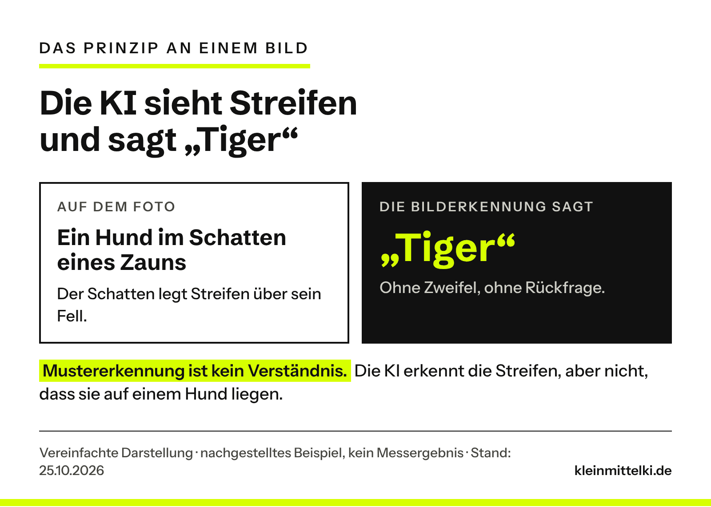
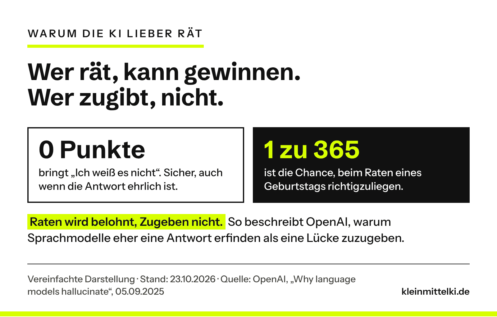
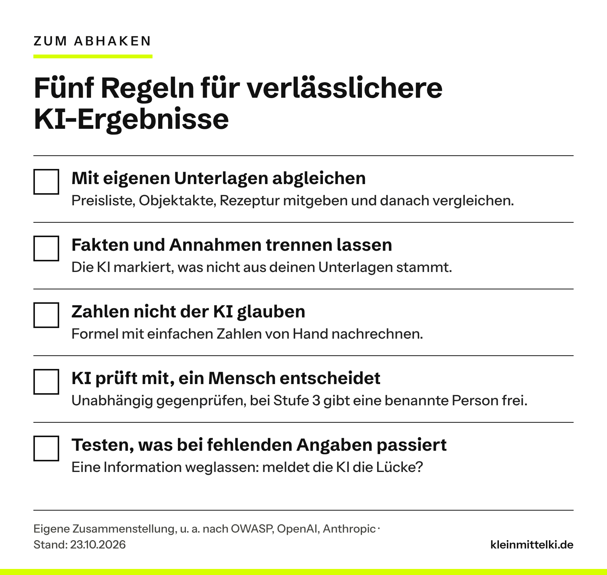

INTERN – vor Veröffentlichung entfernen: Überarbeitung 25.10.2026 nach deinem Wunsch (Chat): (a) Neue Überschrift, selbsterklärend; Vorschaubild neu. (b) Bild-Beispiel aus dem LinkedIn-Material als eigene Grafik nachgestellt (Hund im Zaunschatten wird als „Tiger“ erkannt – so zeigt es das Bild in deinem Material; falls du einen Löwen meinst, tauschen wir das Tier). Das Original-Bild nutzen wir nicht: Rechte und Herkunft sind unklar, und der CI-Baukasten erlaubt keine fremden Bilder. Im Text steht ausdrücklich, dass es eine Illustration ist und streng genommen eine falsche Bilderkennung, keine Halluzination. (c) Fachlich korrigiert nach erneutem Abgleich mit den Originalquellen: OpenAI sagt nicht, dass Sprachmodelle „nie fehlerfrei“ werden, sondern dass sie nie alle Fragen richtig beantworten können und Halluzinationen vermeidbar sind, wenn das Modell Unsicherheit zugibt; der Satz „Darauf hast du keinen Einfluss“ widersprach Regel 2; „falsche Daten“ heißt jetzt „falsche Datumsangaben“ (OpenAI meint dates); der Tipp „in einem neuen Chat“ ist jetzt als unser eigener Zusatz erkennbar, nicht als Anthropic-Zitat; die Excel-Rechnung sagt jetzt klar, dass 285 € die Formel ohne den Einheitenfehler ist, nicht eine vollständige Schwundkalkulation. Neu und belegt: OpenAIs Erklärung, woher Halluzinationen kommen (Rechtschreibung folgt Mustern, der Geburtstag eines Haustiers nicht). (d) Verständlicher: Fachwörter erklärt (Sprachmodell, Deckungsbeitrag, Marge, Prompt), „Audit“ und „Zellbezüge“ ersetzt. Schaubild Exposé entfällt (der Text erklärt es), damit es bei fünf Grafiken bleibt. OLG-Hamm-Beitrag ist jetzt verlinkt. (e) Nach der unabhängigen Prüfung (Runde 5) zusätzlich geschärft: OWASP nennt übermäßiges Vertrauen ein verwandtes Problem, nicht die Ursache; „genauso sicher“ heißt jetzt „kann genauso sicher klingen“; Tipp „neuer Chat“ ersetzt durch „temporärer Chat“ (ein normaler neuer Chat kann frühere Gespräche einbeziehen, zwei neue OpenAI-Quellen); Steckachse, Marge und Schwund für Laien erklärt; „die meisten Fehler“ → „viele Fehler“. (f) 25.10. vormittags nach deinem zweiten Wunsch: Ton ausgewogener (Einleitung, Kurzfassung, Satz nach Regel 5), Regel 2 mit deiner Idee „Erfinde keine Fakten“ und einer Studie (Communications Medicine 2025: Anweisung senkt erfundene Ausführungen von 66 auf 44 Prozent, nicht auf null), dein Prompt im Kasten um zwei Sätze ergänzt („Wenn du etwas nicht sicher weißt …“, „Erfinde keine Zahlen …“) – bitte bestätigen. Bild: Das LinkedIn-Bild nutzen wir nicht (Rechte unklar, Quelle nennen reicht nicht). Kommt ein KI-Bild von dir, ersetzt es die linke Seite von g6, gekennzeichnet als „mit KI erstellt“. Weiter offen von dir: (1) Steckachse – dein Text sagt nur, dass für die „100 %“ Angaben fehlten, nicht dass die Achse nicht gepasst hat; so steht es auch im Beitrag. (2) Redaktionell formuliert, bitte gegenlesen: Einleitungsabsatz 2, der Gedanke zum Mitnehmen, die Schritte in „Zum Ausprobieren“, die Überschrift des Prompt-Kastens. (3) Exposé und Speisekarte sind ausgedachte Beispiele und so gekennzeichnet. (4) Der LinkedIn-Beitrag von Alex Lichtenberger ist als Anstoß genannt, aber nicht verlinkt (für die Redaktion nicht lesbar).

Die Excel-Datei, die ChatGPT mir für ein Geschäftsmodell gebaut hatte, sah professionell aus: saubere Tabellen, Eingabefelder, automatisch berechnete Kennzahlen. Alles wirkte durchdacht. Nur: Einige Berechnungen stimmten nicht. Ohne meine eigene Kontrolle hätte ich die Fehler möglicherweise übersehen.

Genau das ist das Tückische: KI liegt nicht nur manchmal falsch. Sie kann falschliegen und dabei genauso sicher klingen wie bei richtigen Antworten. Das heißt nicht, dass man KI misstrauen muss. Man sollte aber wissen, wo sie danebenliegen kann, und dort gezielt hinschauen. Den Anstoß, die eigenen Erfahrungen genauer anzusehen, gab ein LinkedIn-Beitrag von Alex Lichtenberger. Hier geht es um die Frage, die daraus folgt: **Wie setzt ein Betrieb KI sinnvoll ein, wenn er sich nicht auf jede Antwort verlassen kann?**

```html
<div class="kmk-kurz" style="border:2px solid #111;border-left:10px solid #D7FF00;padding:18px 22px;margin:28px 0;background:#fff;color:#111"><p style="margin:0 0 12px;font-weight:700;font-size:13px;letter-spacing:3px;text-transform:uppercase;line-height:1.3">Das Wichtigste in 30 Sekunden</p><ul style="margin:0;padding-left:20px;display:grid;gap:8px;line-height:1.5"><li style="margin:0">KI liegt manchmal falsch und kann dabei genauso sicher klingen wie bei richtigen Antworten.</li><li style="margin:0">Typische Fehlerstellen nennt OpenAI selbst: seltene Fakten, Datumsangaben, Zitate und Quellen. Dazu kommen Fragen, bei denen wichtige Angaben fehlen.</li><li style="margin:0">Nicht jede Antwort braucht dieselbe Kontrolle. Drei Stufen helfen: frei nutzen, gezielt prüfen, nur mit Freigabe.</li><li style="margin:0">Ein Zusatz im Prompt hilft: der KI erlauben, „weiß ich nicht“ zu sagen. In einer Studie senkte eine solche Anweisung die Fehler deutlich, aber nicht auf null.</li><li style="margin:0">Bei Kalkulationen hilft ein einfacher Test: eine zentrale Formel mit wenigen, leicht nachvollziehbaren Zahlen nachrechnen.</li></ul></div>
```

## Warum KI so überzeugend danebenliegen kann

Ein Bild macht das Prinzip greifbar. Stell dir ein Foto vor: Ein Hund steht im Schatten eines Zauns, die Schattenstreifen lassen sein Fell gestreift aussehen. Eine Bilderkennung soll sagen, was auf dem Foto ist, und antwortet: Tiger.



Die KI hat ein Muster erkannt, aber nicht verstanden, was sie sieht. Und sie meldet keinen Zweifel. Streng genommen ist das keine Halluzination, sondern eine falsche Bilderkennung, und das Beispiel ist ausgedacht, kein Messergebnis. Das Grundproblem ist aber dasselbe wie bei ChatGPT: Die Antwort folgt einem Muster, nicht geprüftem Wissen.

Wenn ein Sprachmodell wie ChatGPT auf diese Weise etwas Falsches behauptet, heißt das **Halluzination**. OpenAI, der Hersteller von ChatGPT, beschreibt das in einem Forschungsbeitrag vom September 2025 als plausible, aber falsche Aussagen, die ein Sprachmodell erzeugt. Sprachmodelle sind die Technik hinter ChatGPT und ähnlichen KI-Assistenten.

Woher die Fehler kommen, erklärt OpenAI so: Sprachmodelle lernen zuerst an riesigen Textmengen, wie ein Text weitergeht. Rechtschreibung folgt festen Mustern. Solche Fehler verschwinden, je größer die Modelle werden. Seltene Einzelfakten wie der Geburtstag eines Haustiers folgen keinem Muster. Bei solchen Fakten entstehen Halluzinationen.

Wie das aussieht, zeigt OpenAI an einem der Autoren des Forschungsbeitrags. Als das Team einen verbreiteten Chatbot nach dem Titel der Doktorarbeit dieses Autors fragte, gab er drei verschiedene Antworten. Keine davon stimmte. Beim Geburtstag war es genauso.

Dazu kommt: Die Tests, mit denen Sprachmodelle trainiert und verglichen werden, zählen meist nur richtige Antworten. So lohnt sich Raten mehr als ein ehrliches „Ich weiß es nicht“. OpenAI vergleicht das mit einem Test: Wer den Geburtstag einer Person nicht kennt und rät, liegt immerhin mit einer Chance von 1 zu 365 richtig. Wer „weiß ich nicht“ schreibt, bekommt sicher null Punkte. Also rät das Modell.



Wichtig ist auch, was OpenAI daraus folgert: Alle Fragen richtig beantworten werden Sprachmodelle nie, weil sich manche Fragen schlicht nicht beantworten lassen. Halluzinationen sind trotzdem kein Naturgesetz: Ein Modell kann bei Unsicherheit auch sagen, dass es etwas nicht weiß. Wie ein Modell trainiert wird, kannst du nicht beeinflussen. Wie du fragst und mit den Antworten umgehst, schon.

Auch die Hilfeseite von OpenAI zu ChatGPT sagt ausdrücklich, dass ChatGPT sicher klingen kann, auch wenn es falschliegt. Als typische Fehler nennt sie falsche Datumsangaben und Fakten sowie erfundene Zitate, Studien und Verweise auf Quellen, die es nicht gibt. Die Empfehlung des Herstellers selbst: ChatGPT als ersten Entwurf nutzen, nicht als endgültige Quelle.

Nicht jeder Fehler ist dabei eine Halluzination. Eine falsch zugeordnete Excel-Zelle (siehe Fall 2) kann auch ein Logikfehler sein. Für dich macht das wenig Unterschied: **Eine KI-Antwort ist ein Vorschlag, kein Ergebnis.**

## Drei eigene Fälle: sicher im Ton, falsch in der Sache

In den vergangenen Monaten habe ich mehrfach erlebt, dass ChatGPT etwas mit großer Sicherheit behauptet hat, obwohl wichtige Informationen fehlten oder eine Berechnung schlicht nicht stimmte.

### Fall 1: Eine Steckachse und angeblich 100 Prozent Sicherheit

Für einen Fahrradanhänger an meinem Mountainbike brauchte ich eine passende Steckachse, also die Achse, die das Hinterrad im Rahmen hält und an der der Anhänger befestigt wird. ChatGPT empfahl ein Modell, mit Gewindesteigung, Achslänge und Zubehör, und war sich irgendwann „100 %“ sicher, dass es passt.

Für diese Sicherheit fehlten entscheidende Informationen. ChatGPT hatte unter anderem aus der Breite der Hinterradnabe von 148 Millimetern auf die passende Achse geschlossen. Wie lang die Achse sein muss und welches Gewinde der Rahmen hat, folgt daraus aber nicht. Beides war nicht überprüft. Auf Nachfrage blieb es zunächst trotzdem dabei. Erst später räumte ChatGPT ein, dass man für eine verlässliche Aussage die Originalachse genauer prüfen müsste.

ChatGPT hatte nicht alle nötigen Informationen, aber trotzdem eine eindeutige Antwort. Für einen Handwerksbetrieb wird das relevant, wenn die KI ein Ersatzteil oder Material empfiehlt. Eine plausible Produktempfehlung ersetzt keine geprüften technischen Daten und erst recht keine Freigabe des Herstellers.

### Fall 2: Eine professionelle Excel-Kalkulation mit falscher Rechnung

Diesen Fall finde ich für kleine Betriebe besonders interessant. Es ging um genau das, was auch eine Bäckerei oder ein Gastronom regelmäßig kalkuliert: Preise, Verbrauchsmaterial, Schwund, Umsatz und Rentabilität.

Der erste Fehler: ChatGPT verwechselte wiederholt die Zellen für den Schwund in Prozent und das Verbrauchsmaterial in Euro. Fünf Prozent Schwund müssen anders behandelt werden als zehn Cent Material pro Einheit. Wer das vertauscht, verändert die ganze Kalkulationslogik.

Der zweite Fehler steckte in der Formel für den jährlichen Bruttogewinn:

```html
<div class="kmk-errors"><p class="kmk-errors__head">Die Formel aus der KI-Tabelle</p><p><strong>=((B8-B9-B11)/B8)*C34*(1-B10/100)</strong></p><p>B8: Verkaufspreis pro Einheit · B9: Einkaufspreis pro Einheit · B10: Schwund in Prozent · B11: Verbrauchsmaterial pro Einheit · C34: Anzahl der Verkäufe pro Jahr</p></div>
```

Fällt dir der Fehler auf?

Die Division durch den Verkaufspreis macht aus dem Gewinn pro Einheit eine Marge, also einen Anteil am Preis: 3 von 10 Euro sind 30 Prozent. Diesen Anteil hat die Formel dann aber nicht mit dem Umsatz in Euro multipliziert, sondern mit der Stückzahl. Ein Anteil mal Stückzahl ergibt keinen Bruttogewinn in Euro.

Mit einfachen Beispielzahlen statt der Originaldaten: Verkaufspreis 10,00 €, Einkaufspreis 6,00 €, Verbrauchsmaterial 1,00 €, 100 Stück im Jahr eingeplant, 5 % Schwund (verkauft werden also 95). Pro Stück bleiben nach Einkauf und Material 3 Euro übrig, der sogenannte Deckungsbeitrag. Rechnet man den Schwund so wie die Tabelle, also vereinfacht als weniger verkaufte Stück, ergibt sich 3 € × 100 × 0,95 = 285 €. Das ist der Bruttogewinn, den die Formel nach ihrer eigenen Logik liefern sollte. Sie liefert aber nur 28,50. Eine vollständige Kalkulation müsste außerdem berücksichtigen, dass die verdorbene Ware trotzdem eingekauft wurde. Darum geht es hier aber nicht: Schon dieser eine Fehler, ein Anteil statt Euro, macht aus 285 Euro 28,50.


Dazu kam das Wachstum. Es sollte sich jeweils auf das Vorjahr beziehen: Bei 100.000 Euro Umsatz und zehn Prozent pro Jahr sind das 110.000 Euro im zweiten und 121.000 Euro im dritten Jahr, nicht 120.000 Euro. Das musste ich ausdrücklich korrigieren lassen.

### Fall 3: Kann ChatGPT seine eigenen Fehler erkennen?

Danach fragte ich ChatGPT sinngemäß: „Kannst du unsere bisherigen Chats analysieren und herausfinden, wo du falsche Informationen geliefert hast oder ich dich korrigieren musste?“ Die Antwort war hilfreich: ChatGPT fand unter anderem die Excel-Kalkulation und die Steckachse.

Aber woher weiß ich, ob diese Selbstprüfung vollständig und richtig ist? ChatGPT konnte nicht garantieren, dass ihm alle früheren Gespräche und Anhänge zur Verfügung standen. Und ich musste trennen, was sich an Gesprächsstellen belegen ließ und was nur Interpretation war. Auch die Kontrolle musste ich also wieder hinterfragen. KI kann Unstimmigkeiten aufdecken und Formeln hinterfragen. Eine Selbstprüfung ist aber kein unabhängiger Beweis, dass alles stimmt.

## Das eigentliche Risiko: Niemand schaut mehr hin

Das OWASP Gen AI Security Project, eine weltweite, offene Initiative von Fachleuten für IT-Sicherheit, führt Fehlinformation durch Sprachmodelle in seiner Liste der zehn wichtigsten Risiken für Anwendungen mit Sprachmodellen (Stand 2025). Dazu nennt es ein verwandtes Problem: übermäßiges Vertrauen. Menschen prüfen die Ausgaben nicht genug und übernehmen falsche Angaben in Entscheidungen und Abläufe. Das verstärkt den Schaden. Als mögliche Folgen von Fehlinformation nennt OWASP Reputationsschäden und rechtliche Haftung.

Fall 2 zeigt, warum das so leicht passiert: Je professioneller ein Ergebnis aussieht, desto fertiger wirkt es. Auch im [Protokoll-Selbstversuch](https://www.kleinmittelki.de/protokoll-per-ki-selbstversuch/) hier im Blog waren im fertig wirkenden Entwurf einige Namen falsch geschrieben.

Was ein Chatbot auf der Website deines Betriebs sagt, sagst am Ende du. So hat das [OLG Hamm](https://www.kleinmittelki.de/olg-hamm-chatbot-haftung/) die Falschangaben eines Website-Chatbots dem Betreiber zugerechnet. Und was die KI ins Angebot schreibt, unterschreibst du.

Zwei ausgedachte Beispiele zeigen weitere Fehlerarten:

**Immobilien: das Exposé.** Der Makler notiert: „Dach vermutlich um 2010 erneuert, Eigentümer unsicher“. Im Exposé steht: „Dach 2010 komplett saniert.“ Aus einer Vermutung ist eine Tatsache geworden, die keiner belegen kann.

**Gastronomie: die neue Speisekarte.** Die Inhaberin lässt die Karte von der KI kürzer formulieren. Dabei fällt bei einem Gericht der Hinweis auf Nüsse weg, bei einem anderen steht plötzlich „glutenfrei“. Hier geht es nicht mehr um Stil, sondern um die Gesundheit von Gästen.

## Nicht jede Antwort braucht dieselbe Kontrolle

Alles zu prüfen, ist nicht realistisch. Einen Instagram-Entwurf kann man von der KI schreiben lassen und kurz durchlesen. Bei einer Finanzkalkulation, einem verbindlichen Angebot oder einer automatisierten Preisänderung haben kleine Fehler direkte wirtschaftliche Folgen. Sinnvoller ist eine Frage vorab, aus der sich drei Stufen ergeben:

**Was passiert, wenn dieser Fehler unbemerkt durchrutscht?**

**Stufe 1: Frei nutzen.** Ideen, Überschriften, erste Entwürfe, Formulierungen für eine schwierige Mail. Ein Fehler fällt sofort auf oder schadet nicht, weil ohnehin ein Mensch weiterarbeitet.

**Stufe 2: Gezielt prüfen.** Angebote, Exposés, Kundenantworten, Auswertungen. Das Ergebnis geht an Kunden oder fließt in Entscheidungen. Geprüft wird gezielt: Zahlen, Namen, Daten, Zusagen und alles, was nach Tatsache klingt.

**Stufe 3: Nur mit Freigabe.** Buchungen, Preise, Zahlungen, Allergen- und Sicherheitsangaben. Ein Fehler kostet Geld, gefährdet Menschen oder lässt sich nicht zurücknehmen. Die KI darf vorbereiten. Ausgeführt wird erst, wenn eine benannte Person freigegeben hat, am besten gegen feste Regeln wie eine Preisliste.


Die Speisekarte ist Stufe 1, solange es um den Ton geht, und Stufe 3, sobald Allergene darin stehen.

Für den Einstieg reicht eine kurze Teamrunde: Sammelt, wofür bei euch KI genutzt wird, auch im privaten Konto ohne Wissen des Betriebs (siehe [Schatten-KI](https://www.kleinmittelki.de/schatten-ki-deine-mitarbeiter-nutzen-ki-vielleicht-langst-weisst-du-wofur/)), und ordnet jeden Punkt einer Stufe zu. Stufe 2 und 3 brauchen einen klaren Prüfschritt und einen Namen. Dieselbe Logik gilt, wenn KI später selbst handelt, siehe [KI-Agenten: Was nach dem Chatbot kommt](https://www.kleinmittelki.de/ki-agenten-was-nach-dem-chatbot-kommt-und-was-kmu-davon-haben/).

## Fünf Regeln, die viele Fehler abfangen

Für Stufe 2 und 3 helfen fünf Regeln. Regel 1 und 2 stützen sich auf Empfehlungen von OWASP und von Anthropic, dem Hersteller des KI-Assistenten Claude, sowie auf eine Studie. Regel 3 bis 5 sind praktische Ergänzungen aus den drei Fällen und dem Betriebsalltag.



**1. Mit eigenen Unterlagen abgleichen.** Preise gehören in die Preisliste, Allergene in die Rezeptur, technische Maße ins Datenblatt des Herstellers. Gib der KI diese Unterlagen mit und gleiche das Ergebnis mit ihnen ab. Das entspricht der Empfehlung von OWASP: Antworten auf geprüfte, vertrauenswürdige Quellen stützen und kritische Inhalte von Menschen gegenprüfen lassen.

**2. Fakten und Annahmen trennen lassen.** Ein Satz wie „Erfinde keine Fakten“ ist ein guter Anfang. Allein reicht er aber nicht, denn laut OpenAI kann die KI auch bei falschen Antworten sehr sicher klingen. Hilfreich ist deshalb, ihr ausdrücklich einen Ausweg zu geben: Erlaube ihr zu sagen, dass sie etwas nicht weiß, und lass sie Fakten von Annahmen trennen. Anthropic schreibt in der Dokumentation zu seinem Modell Claude, dass diese Erlaubnis falsche Angaben deutlich verringern kann.

Wie viel so eine Anweisung bringt, zeigt eine Studie aus der Medizin (Communications Medicine, August 2025). Der Test war absichtlich schwer: Forschende versteckten in 300 Fallbeschreibungen je einen erfundenen Begriff, etwa einen Laborwert, den es nicht gibt, und legten sie sechs KI-Modellen vor. Ohne Zusatz gingen die Modelle im Schnitt in 66 Prozent der Fälle auf den erfundenen Begriff ein, als gäbe es ihn. Mit der Anweisung, nur gesicherte Informationen zu verwenden und Unsicherheit zuzugeben, statt zu spekulieren, waren es 44 Prozent. Die Prozentwerte gelten für diesen Test mit absichtlich falschen Angaben, nicht für normale Fragen im Alltag. Das Fazit der Autoren: Die Anweisung verringert Fehler, beseitigt sie aber nicht.

Wenn ich heute nach technischen Produkten frage, will ich auch wissen, welche Angaben für eine sichere Aussage fehlen. Ein hilfreicher Zusatz für die Anweisung an die KI, den sogenannten Prompt:

```html
<div class="kmk-prompt"><p class="kmk-prompt__label">Mein Zusatz für technische Fragen</p><p class="kmk-prompt__text">„Wenn du etwas nicht sicher weißt, sag das, statt zu raten. Erfinde keine Zahlen, Quellen oder technischen Daten. Nenne mir ausdrücklich alle Angaben, die für eine zuverlässige Empfehlung noch fehlen. Trenne bestätigte Fakten von Annahmen und behaupte keine Sicherheit, wenn wichtige Informationen nicht geprüft wurden.“</p></div>
```

Das verbessert die Ausgangslage, garantiert aber keine richtige Antwort. Auch Anthropic schreibt, dass solche Techniken Halluzinationen verringern, aber nicht ganz beseitigen.

Noch ein Tipp aus der Anthropic-Dokumentation: Stell dieselbe Frage mehrmals und vergleiche die Antworten. Weichen sie voneinander ab, ist das ein Warnsignal. Praktisch heißt das: Die KI sollte ihre erste Antwort dabei nicht kennen. Bei ChatGPT geht das am sichersten in einem temporären Chat, denn ein normaler neuer Chat kann je nach Einstellung frühere Gespräche einbeziehen.

**3. Zahlen nicht der KI glauben.** Bei Kalkulationen prüfst du nicht nur das Ergebnis, sondern die Logik: Greifen die Formeln auf die richtigen Zellen zu? Werden Prozent und Euro unterschieden, Umsatz in Euro und verkaufte Stückzahl getrennt? Bezieht sich eine Steigerung auf die richtige Basis? Stimmt ein Wert, den du einmal selbst nachrechnest? Wenn nicht, gehört die ganze Kalkulation auf den Prüfstand.

**4. Die KI darf mitprüfen, aber nicht allein über ihre eigene Arbeit entscheiden.** Fall 3 zeigt die Grenze. Bei wichtigen Ergebnissen braucht es eine unabhängige Kontrolle: eine separate Rechnung, den Abgleich mit Originaldokumenten oder jemanden mit Fachwissen. Eine zweite KI kann helfen, ersetzt aber keine unabhängige Faktenbasis. Bei Stufe 3 gibt eine benannte Person frei. In einem Betrieb mit 30 Leuten kann das die Bürokraft für Angebote sein und die Küchenchefin für die Speisekarte.

**5. Testen, was bei fehlenden Angaben passiert.** Lass bewusst eine Information weg. Meldet die KI die Lücke oder füllt sie sie mit etwas Plausiblem, wie bei der Steckachse?

Das klingt nach viel Aufwand, betrifft aber nur Stufe 2 und 3. Für Ideen, Entwürfe und Formulierungen kannst du KI weiter frei nutzen.

```html
<div class="kmk-kurz" style="border:2px solid #111;border-left:10px solid #D7FF00;padding:18px 22px;margin:28px 0;background:#fff;color:#111"><p style="margin:0 0 12px;font-weight:700;font-size:13px;letter-spacing:3px;text-transform:uppercase;line-height:1.3">Zum Ausprobieren: eine Kalkulation nachrechnen</p><ol style="margin:0;padding:0;list-style:none;display:grid;gap:10px;line-height:1.5"><li style="margin:0;display:grid;grid-template-columns:30px 1fr;gap:10px;align-items:start"><span style="background:#D7FF00;font-weight:700;text-align:center;line-height:30px;height:30px">1</span><span>Nimm eine Kopie einer Tabelle, die eine KI für dich gebaut hat, etwa eine Preiskalkulation.</span></li><li style="margin:0;display:grid;grid-template-columns:30px 1fr;gap:10px;align-items:start"><span style="background:#D7FF00;font-weight:700;text-align:center;line-height:30px;height:30px">2</span><span>Such die zentrale Formel und notiere für jede Zelle darin die Einheit: Euro, Prozent oder Stück.</span></li><li style="margin:0;display:grid;grid-template-columns:30px 1fr;gap:10px;align-items:start"><span style="background:#D7FF00;font-weight:700;text-align:center;line-height:30px;height:30px">3</span><span>Trag einfache Zahlen ein: 10,00 € Verkaufspreis, 6,00 € Einkauf, 1,00 € Material, 100 Stück eingeplant, 5 % Schwund.</span></li><li style="margin:0;display:grid;grid-template-columns:30px 1fr;gap:10px;align-items:start"><span style="background:#D7FF00;font-weight:700;text-align:center;line-height:30px;height:30px">4</span><span>Rechne von Hand nach: Behandelt die Tabelle den Schwund als weniger verkaufte Stück, sind es 3 € × 100 × 0,95 = 285 €. Zeigt sie 28,50, wird wahrscheinlich durch den Verkaufspreis geteilt. Bei anderen Werten prüf, wie die Tabelle den Schwund rechnet und ob Zellen vertauscht sind.</span></li><li style="margin:0;display:grid;grid-template-columns:30px 1fr;gap:10px;align-items:start"><span style="background:#D7FF00;font-weight:700;text-align:center;line-height:30px;height:30px">5</span><span>Prüf das Wachstum: 100.000 € Umsatz und 10 % pro Jahr müssen im dritten Jahr 121.000 € ergeben, nicht 120.000 €.</span></li><li style="margin:0;display:grid;grid-template-columns:30px 1fr;gap:10px;align-items:start"><span style="background:#D7FF00;font-weight:700;text-align:center;line-height:30px;height:30px">6</span><span>Frag bei Abweichungen nach dem Warum, etwa: <em>„Warum teilst du hier durch den Verkaufspreis?“</em> Die Korrektur prüfst du mit denselben Zahlen.</span></li></ol></div>
```

## Meine Einschätzung

Trotz dieser Beispiele würde ich nicht auf die Idee kommen, weniger KI einzusetzen. Gerade kleine Betriebe können damit Angebote vorbereiten, Dokumente strukturieren, Daten auswerten oder erste Kalkulationen entwickeln, wofür früher deutlich mehr Zeit oder Hilfe von außen nötig war. Entscheidend ist, wie man die Ergebnisse in die eigenen Abläufe einbaut.

KI muss nicht perfekt sein, um sehr nützlich zu sein. Ich nutze ChatGPT weiterhin fast täglich. Aber ich habe gelernt, eine überzeugend formulierte Antwort nicht mit einer richtigen gleichzusetzen. Eine professionell aussehende Excel-Datei ist noch keine richtige Kalkulation. Eine konkrete Produktempfehlung ist noch keine geprüfte Kompatibilität. Und eine Selbstkontrolle durch KI ist noch keine unabhängige Qualitätsprüfung.

Vielleicht ist genau das eine der wichtigsten Fähigkeiten im Umgang mit KI: nicht nur zu wissen, wie man gute Antworten bekommt, sondern auch, wann man sie besser noch einmal überprüft. KI kann uns viel Arbeit abnehmen. Die Verantwortung für das Ergebnis nimmt sie uns nicht ab.

## Ein Gedanke zum Mitnehmen

Nimm die letzte Kalkulation oder das letzte Angebot, an dem bei euch eine KI mitgearbeitet hat. Ist klar geregelt, wer oder was das Ergebnis überprüft?

## Quellen

Abgerufen am 23.10.2026, zuletzt geprüft am 25.10.2026

- [OpenAI: Why language models hallucinate (05.09.2025)](https://openai.com/index/why-language-models-hallucinate/)
- [OpenAI Help Center: Does ChatGPT tell the truth? (abgerufen 23.10.2026)](https://help.openai.com/en/articles/8313428-does-chatgpt-tell-the-truth)
- [OWASP Gen AI Security Project: LLM09:2025 Misinformation (OWASP Top 10 for LLM Applications 2025, Stand 17.04.2025)](https://genai.owasp.org/llmrisk/llm092025-misinformation/)
- [Anthropic, Claude-Dokumentation: Reduce hallucinations (abgerufen 23.10.2026)](https://platform.claude.com/en/docs/test-and-evaluate/strengthen-guardrails/reduce-hallucinations)
- [Omar, Klang u. a.: Multi-model assurance analysis showing large language models are highly vulnerable to adversarial hallucination attacks during clinical decision support. Communications Medicine 5, 330 (02.08.2025)](https://doi.org/10.1038/s43856-025-01021-3)
- [OpenAI Help Center: Temporary Chat FAQ (abgerufen 25.10.2026)](https://help.openai.com/en/articles/8914046)
- [OpenAI Help Center: Memory FAQ (abgerufen 25.10.2026)](https://help.openai.com/en/articles/8983136)
