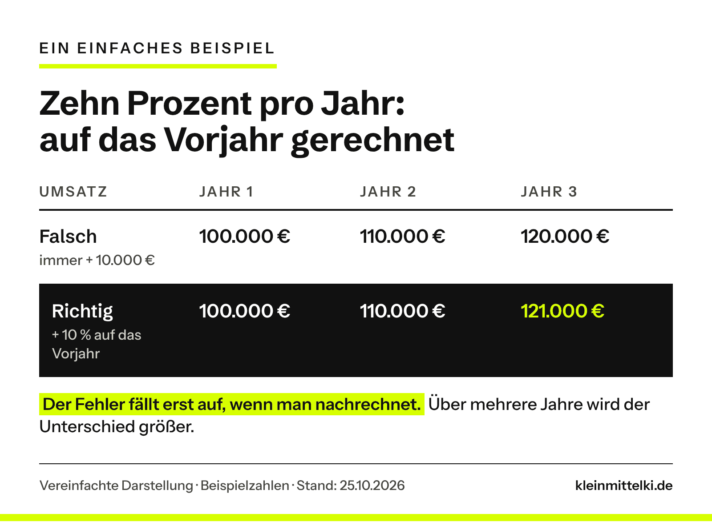

INTERN – vor Veröffentlichung entfernen: Fokussierte Fassung vom 25.10.2026 nach deinem Feedback (Excel unverständlich, zu lang, keine Hinweise auf ein eigenes Geschäftsmodell wegen Vusion): rund 1.000 Wörter. Excel-Fall ohne Formel, nur das Wachstum als einfaches Beispiel (neue Grafik g7, Beispielzahlen wie in deinem Text) und ein Satz zur Prozent-Formel; kein „Geschäftsmodell“ mehr, kein Zweck der Tabelle. Steckachse und Selbstprüfung nur noch je ein Satz. Fünf Regeln → drei. Schaubilder g4 und g5 entfallen. Tiger-Foto bleibt (dein Wunsch; Vorlage war das Originalbild aus dem Netz, gekennzeichnet als „mit KI nachgestellt“). Im Prompt-Kasten („Mein Zusatz“) stehen zwei Sätze der Redaktion („Wenn du etwas nicht sicher weißt …“, „Erfinde keine Zahlen …“); du hast die Entscheidung der Redaktion überlassen. Offen: Der LinkedIn-Beitrag von Alex Lichtenberger ist als Anstoß genannt, nicht verlinkt.

Die Excel-Kalkulation, die ChatGPT mir gebaut hatte, sah professionell aus: saubere Tabellen, Eingabefelder, automatisch berechnete Kennzahlen. Nur: Einige Berechnungen stimmten nicht. Ohne eigene Kontrolle hätte ich die Fehler möglicherweise übersehen.

Genau das ist das Tückische: KI kann falschliegen und dabei genauso sicher klingen wie bei richtigen Antworten. Das heißt nicht, dass man KI misstrauen muss. Man sollte aber wissen, wo sie danebenliegen kann, und dort gezielt hinschauen. Den Anstoß zu diesem Beitrag gab ein LinkedIn-Beitrag von Alex Lichtenberger. **Wie setzt ein Betrieb KI sinnvoll ein, wenn er sich nicht auf jede Antwort verlassen kann?**

```html
<div class="kmk-kurz" style="border:2px solid #111;border-left:10px solid #D7FF00;padding:18px 22px;margin:28px 0;background:#fff;color:#111"><p style="margin:0 0 12px;font-weight:700;font-size:13px;letter-spacing:3px;text-transform:uppercase;line-height:1.3">Das Wichtigste in 30 Sekunden</p><ul style="margin:0;padding-left:20px;display:grid;gap:8px;line-height:1.5"><li style="margin:0">KI kann falschliegen und dabei genauso sicher klingen wie bei richtigen Antworten.</li><li style="margin:0">Typische Fehlerstellen nennt OpenAI selbst: seltene Fakten, Datumsangaben, Zitate und Quellen. Dazu kommen Fragen, bei denen wichtige Angaben fehlen.</li><li style="margin:0">Nicht jede Antwort braucht dieselbe Kontrolle. Entscheidend ist, was ein unbemerkter Fehler anrichten würde.</li><li style="margin:0">Ein Zusatz im Prompt hilft: der KI erlauben, „weiß ich nicht“ zu sagen. In einer Studie senkte eine solche Anweisung die Fehler deutlich, aber nicht auf null.</li><li style="margin:0">Zahlen aus der KI rechnest du an einer Stelle selbst nach, bevor du dich auf sie verlässt.</li></ul></div>
```

## Professionell aussehen heißt nicht richtig rechnen

Die Tabelle rechnete mit Preisen, Einkauf, Material und Umsatz, also mit genau dem, was auch eine Bäckerei oder ein Handwerksbetrieb plant. Am einfachsten zu sehen war der Fehler beim Wachstum. Ich wollte, dass sich die jährliche Steigerung auf das jeweilige Vorjahr bezieht. Die Tabelle rechnete das zunächst anders. Ein einfaches Beispiel zeigt, warum das zählt: Zehn Prozent pro Jahr auf 100.000 Euro ergeben im dritten Jahr 121.000 Euro, nicht 120.000.



Dazu kam eine Formel, die mit einem Prozentwert weiterrechnete, wo ein Eurobetrag hingehört hätte. Heraus kam ein Gewinn, der so nicht stimmen konnte.

Ähnliches habe ich öfter erlebt. Bei einer Steckachse für einen Fahrradanhänger war sich ChatGPT „100 %“ sicher, obwohl entscheidende Angaben fehlten. Und als ich ChatGPT bat, in unseren Chats die eigenen Fehler zu suchen, fand es unter anderem die Kalkulation und die Steckachse, konnte aber nicht garantieren, dass es alle gefunden hatte.

## Warum KI so überzeugend danebenliegt

Ein Bild macht das Prinzip greifbar: Ein Hund liegt im Schatten eines Zauns, die Schattenstreifen lassen sein Fell gestreift aussehen. Eine Bilderkennung, die nur auf das Muster schaut, könnte daraus einen Tiger machen.


Die KI würde das Muster erkennen, aber nicht den Zusammenhang: den Zaun, der den Schatten wirft. Das Motiv kursiert im Netz, unsere Fassung ist mit KI nachgestellt und kein Messergebnis. Streng genommen zeigt es eine falsche Bilderkennung. Das Prinzip ist aber dasselbe wie bei ChatGPT: Die Antwort folgt einem Muster, nicht geprüftem Wissen.

Bei Sprachmodellen wie ChatGPT heißt das **Halluzination**: plausible, aber falsche Aussagen, so die Definition von OpenAI in einem Forschungsbeitrag vom September 2025. Sprachmodelle lernen an riesigen Textmengen, wie ein Text weitergeht. Rechtschreibung folgt festen Mustern, seltene Einzelfakten wie der Geburtstag eines Haustiers nicht. Bei solchen Fakten entstehen Halluzinationen. Dazu kommt: Die Tests, mit denen Sprachmodelle trainiert und verglichen werden, zählen meist nur richtige Antworten. Wer rät, hat eine Chance. Wer „weiß ich nicht“ sagt, bekommt sicher null Punkte. Also rät das Modell.


Als typische Fehler nennt OpenAI falsche Datumsangaben sowie erfundene Zitate und Quellen und empfiehlt, ChatGPT als ersten Entwurf zu nutzen, nicht als endgültige Quelle. Nicht jeder Fehler ist dabei eine Halluzination, manche sind Rechen- oder Logikfehler wie in meiner Tabelle. Für dich zählt dasselbe: **Eine KI-Antwort ist ein Vorschlag, kein Ergebnis.**

Gefährlich wird das, wenn niemand mehr hinschaut. Je professioneller ein Ergebnis aussieht, desto fertiger wirkt es. Auch im [Protokoll-Selbstversuch](https://www.kleinmittelki.de/protokoll-per-ki-selbstversuch/) hier im Blog waren im fertig wirkenden Entwurf einige Namen falsch geschrieben. Und was ein Chatbot auf der Website deines Betriebs sagt, sagst am Ende du: So hat das [OLG Hamm](https://www.kleinmittelki.de/olg-hamm-chatbot-haftung/) die Falschangaben eines Website-Chatbots dem Betreiber zugerechnet.

## Nicht jede Antwort braucht dieselbe Kontrolle

Alles zu prüfen, ist nicht realistisch. Entscheidend ist eine Frage: **Was passiert, wenn dieser Fehler unbemerkt durchrutscht?**

**Stufe 1: Frei nutzen.** Ideen, Überschriften, erste Entwürfe. Ein Fehler fällt sofort auf oder schadet nicht.

**Stufe 2: Gezielt prüfen.** Angebote, Exposés, Kundenantworten, Auswertungen. Geprüft werden Zahlen, Namen, Daten, Zusagen und alles, was nach Tatsache klingt.

**Stufe 3: Nur mit Freigabe.** Buchungen, Preise, Zahlungen, Allergen- und Sicherheitsangaben. Die KI darf vorbereiten, ausgeführt wird erst nach Freigabe durch eine benannte Person.


Ein Beispiel aus der Gastronomie: Lässt die Inhaberin ihre Speisekarte von der KI kürzer formulieren, ist das Stufe 1. Fällt dabei aber der Hinweis auf Nüsse weg, geht es um die Gesundheit von Gästen, und das ist Stufe 3. Für den Einstieg reicht eine kurze Teamrunde: Sammelt, wofür bei euch KI genutzt wird, auch im privaten Konto ohne Wissen des Betriebs (siehe [Schatten-KI](https://www.kleinmittelki.de/schatten-ki-deine-mitarbeiter-nutzen-ki-vielleicht-langst-weisst-du-wofur/)), und ordnet jeden Punkt einer Stufe zu.

## Drei Regeln für Stufe 2 und 3

**1. Mit eigenen Unterlagen abgleichen.** Preise gehören in die Preisliste, Allergene in die Rezeptur, technische Maße ins Datenblatt. Gib der KI diese Unterlagen mit und gleiche das Ergebnis damit ab. Das empfiehlt auch das OWASP Gen AI Security Project, eine weltweite, offene Initiative von Fachleuten für IT-Sicherheit.

**2. Der KI erlauben, „weiß ich nicht“ zu sagen.** Ein Satz wie „Erfinde keine Fakten“ ist ein guter Anfang. Allein reicht er nicht, denn laut OpenAI kann die KI auch bei falschen Antworten sehr sicher klingen. Erlaube ihr deshalb ausdrücklich, Unsicherheit zuzugeben. Laut Anthropics Dokumentation zu Claude kann das falsche Angaben deutlich verringern. Wie viel so eine Anweisung bringen kann, zeigt eine Studie (Communications Medicine, 2025): In 300 Fallbeschreibungen mit je einem absichtlich erfundenen Begriff gingen sechs KI-Modelle ohne Zusatz im Schnitt in 66 Prozent der Fälle darauf ein, mit der Anweisung, nur Gesichertes zu verwenden und Unsicherheit zuzugeben, in 44 Prozent. Die Werte gelten für diesen absichtlich schweren Test, nicht für den Alltag. Fehler werden also seltener, aber nicht null. Mein Zusatz, wenn ich nach technischen Produkten frage:

```html
<div class="kmk-prompt"><p class="kmk-prompt__label">Mein Zusatz für technische Fragen</p><p class="kmk-prompt__text">„Wenn du etwas nicht sicher weißt, sag das, statt zu raten. Erfinde keine Zahlen, Quellen oder technischen Daten. Nenne mir ausdrücklich alle Angaben, die für eine zuverlässige Empfehlung noch fehlen. Trenne bestätigte Fakten von Annahmen und behaupte keine Sicherheit, wenn wichtige Informationen nicht geprüft wurden.“</p></div>
```

**3. Selbst nachrechnen und selbst entscheiden.** Bei Zahlen reicht oft ein einziger Wert, den du von Hand nachrechnest. Die KI darf mitprüfen, entscheiden muss bei wichtigen Ergebnissen ein Mensch. In einem Betrieb mit 30 Leuten kann das die Bürokraft für Angebote sein und die Küchenchefin für die Speisekarte.

```html
<div class="kmk-kurz" style="border:2px solid #111;border-left:10px solid #D7FF00;padding:18px 22px;margin:28px 0;background:#fff;color:#111"><p style="margin:0 0 12px;font-weight:700;font-size:13px;letter-spacing:3px;text-transform:uppercase;line-height:1.3">Zum Ausprobieren: eine KI-Tabelle in fünf Minuten prüfen</p><ol style="margin:0;padding:0;list-style:none;display:grid;gap:10px;line-height:1.5"><li style="margin:0;display:grid;grid-template-columns:30px 1fr;gap:10px;align-items:start"><span style="background:#D7FF00;font-weight:700;text-align:center;line-height:30px;height:30px">1</span><span>Nimm eine Tabelle, die eine KI für dich gebaut hat, etwa eine Preis- oder Umsatzplanung.</span></li><li style="margin:0;display:grid;grid-template-columns:30px 1fr;gap:10px;align-items:start"><span style="background:#D7FF00;font-weight:700;text-align:center;line-height:30px;height:30px">2</span><span>Such dir einen Wert aus, zum Beispiel den Umsatz im dritten Jahr, und rechne ihn mit dem Taschenrechner nach.</span></li><li style="margin:0;display:grid;grid-template-columns:30px 1fr;gap:10px;align-items:start"><span style="background:#D7FF00;font-weight:700;text-align:center;line-height:30px;height:30px">3</span><span>Weicht er ab, frag nach: <em>„Warum rechnest du hier so?“</em> Die Korrektur prüfst du genauso.</span></li></ol></div>
```

## Meine Einschätzung

Trotz dieser Beispiele würde ich nicht auf die Idee kommen, weniger KI einzusetzen. Gerade kleine Betriebe können damit Angebote vorbereiten, Dokumente strukturieren oder erste Kalkulationen entwickeln, wofür früher deutlich mehr Zeit oder Hilfe von außen nötig war.

KI muss nicht perfekt sein, um sehr nützlich zu sein. Ich nutze ChatGPT weiterhin fast täglich. Aber ich habe gelernt, eine überzeugend formulierte Antwort nicht mit einer richtigen gleichzusetzen. KI kann uns viel Arbeit abnehmen. Die Verantwortung für das Ergebnis nimmt sie uns nicht ab.

## Ein Gedanke zum Mitnehmen

Nimm die letzte Kalkulation oder das letzte Angebot, an dem bei euch eine KI mitgearbeitet hat. Ist klar geregelt, wer das Ergebnis überprüft?

## Quellen

Abgerufen am 23.10.2026, zuletzt geprüft am 25.10.2026

- [OpenAI: Why language models hallucinate (05.09.2025)](https://openai.com/index/why-language-models-hallucinate/)
- [OpenAI Help Center: Does ChatGPT tell the truth? (abgerufen 23.10.2026)](https://help.openai.com/en/articles/8313428-does-chatgpt-tell-the-truth)
- [OWASP Gen AI Security Project: LLM09:2025 Misinformation (OWASP Top 10 for LLM Applications 2025, Stand 17.04.2025)](https://genai.owasp.org/llmrisk/llm092025-misinformation/)
- [Anthropic, Claude-Dokumentation: Reduce hallucinations (abgerufen 23.10.2026)](https://platform.claude.com/en/docs/test-and-evaluate/strengthen-guardrails/reduce-hallucinations)
- [Omar, Klang u. a.: Multi-model assurance analysis showing large language models are highly vulnerable to adversarial hallucination attacks during clinical decision support. Communications Medicine 5, 330 (02.08.2025)](https://doi.org/10.1038/s43856-025-01021-3)
