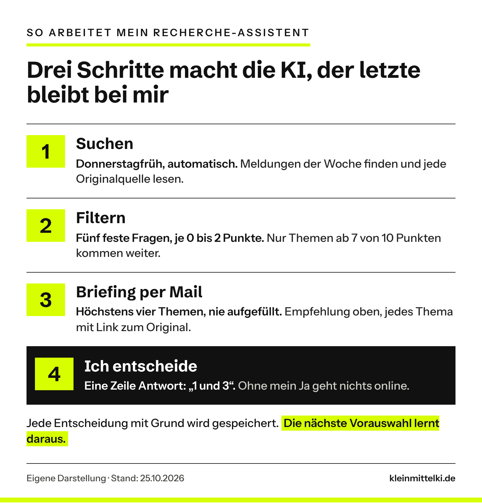

INTERN – vor Veröffentlichung entfernen: Grundlage sind Tills Systemunterlagen (Repo, Übersicht vom 24.10.2026, Wochenbericht KW 43) und der Chat vom 25.10.2026. Von Till stammen sinngemäß: das Ziel (Agenten recherchieren, Till entscheidet, nichts ohne Freigabe), „zu viel und zu unübersichtlich“ zur ersten Fassung und das ChatGPT-Briefing als Vorbild. Als Vorschlag formuliert und bitte bestätigen oder ersetzen: „Genau diese Vorarbeit wollte ich abgeben …“, „Eine Zeitersparnis habe ich nicht gemessen …“, „Der Engpass war nicht die Technik …“ (Deutung aus dem Wochenbericht), das gesamte Fazit inkl. Leitsatz, der Transparenz-Absatz (stimmt „keine Kooperation“?). Die Zahlen 8 Stunden / 3,7 Tage / 46 Minuten stammen aus dem Protokoll der Redaktion zum OLG-Hamm-Beitrag. Die Ausschreibungs-Anfrage im zweiten Kasten ist ein Beispiel der Redaktion, kein Test von Till. Offen: ein Satz zu Aufwand und Kosten der Einrichtung, und gern ein anonymisierter Screenshot des ersten Briefings im neuen Format (Do 29.10.) nach „Was ist dabei herausgekommen?“.

```html
<p class="kmk-series"><span class="kmk-series__name">Selbst ausprobiert</span>Erfahrungsbericht · Recherche-Assistent für diesen Blog, Oktober 2026</p>
```

## Welches Problem soll gelöst werden?

Wer diesen Blog liest, sieht nur das Ergebnis. Davor liegt Arbeit, die niemand sieht: Studien, Urteile und neue Funktionen sichten, die Originalquelle suchen, Wichtiges von Lärm trennen. Genau diese Vorarbeit wollte ich abgeben, ohne die Auswahl aus der Hand zu geben.

Das Problem kennt fast jeder Betrieb. Der Malerbetrieb sucht Ausschreibungen, das Ingenieurbüro neue Normen, die Hausverwaltung Gesetzesänderungen. Meist passiert das nebenbei und mit dem Gefühl, etwas zu verpassen.

Mein Ziel: ein Assistent, der regelmäßig sucht, nach meinen Kriterien filtert und mir das Ergebnis per Mail schickt. Entscheiden will ich selbst.

## Wie lief der Test ab?

Der Assistent ist kein einzelnes Programm, sondern besteht aus vier Bausteinen:

- **Claude von Anthropic** als Arbeitskraft. Es läuft als [geplante Aufgabe in Claude Code](https://code.claude.com/docs/en/web-scheduled-tasks) auf den Servern des Anbieters, also auch dann, wenn mein Rechner aus ist.
- **Gmail** als einziger Kanal. Ich bekomme Mails und antworte darauf.
- **GitHub** als Gedächtnis. Dort liegen meine Kriterien, die Themenliste und jede meiner Entscheidungen mit Begründung.
- **ChatGPT** als zweite Meinung. Themen, die mir ChatGPT vorschlägt, leite ich weiter. Sie zählen erst, wenn der Assistent sie am Original geprüft hat.

Der Ablauf: Donnerstagfrüh sucht der Agent die Meldungen der Woche, liest jede Quelle selbst und bewertet sie. Gegen 8:20 Uhr liegt das Briefing in meinem Postfach. Ich antworte in einer Zeile, zum Beispiel „1 und 3. 2 nein, zu technisch.“ Freigegebene Themen werden direkt ausgearbeitet, der Entwurf kommt als Vorschau-Link. Online geht er erst nach meinem „ja“.



Das Wichtigste sind nicht die Werkzeuge, sondern die Kriterien. Sie stehen schriftlich fest, und der Agent liest sie vor jedem Lauf:

```html
<div class="kmk-prompt"><p class="kmk-prompt__label">Meine Regeln für den Recherche-Agenten (Auszug)</p><p class="kmk-prompt__text">Ein Thema kommt nur in Frage, wenn ein Betrieb mit 1 bis 300 Leuten danach etwas anders entscheiden, prüfen oder ausprobieren kann.<br><br>Bewerte jedes Thema mit 0 bis 2 Punkten je Frage: Betrifft es kleine Betriebe direkt? Kann ein Betrieb danach etwas tun? Gibt es eine belastbare Originalquelle? Ist es neu für den Blog? Passt es zu meinen bisherigen Entscheidungen?<br><br>Schlage nur Themen ab 7 von 10 Punkten vor. Höchstens vier pro Woche, nie auffüllen.<br><br>Keine Modell-Ranglisten, keine Herstellerwerbung, keine Meldung ohne Originalquelle.</p></div>
```

Dazu kommt eine Lernschleife. Jedes Ja und Nein landet mit Grund in einer Liste, die der Agent vor dem nächsten Lauf liest. Eine Funktionsübersicht von Microsoft habe ich zum Beispiel abgelehnt, weil sie sich wie Produktdokumentation liest. Seitdem schlägt er so etwas nicht mehr vor.

## Was ist dabei herausgekommen?

Jeden Donnerstag eine Mail, die auf dem Handy in zwei Minuten gelesen ist. Ganz oben steht die Empfehlung, darunter höchstens vier Themen, jedes gleich aufgebaut:

```html
<ol class="kmk-stufen"><li style="background:#ffffff;border:1px solid #E2E2DE;padding:14px 18px;margin-bottom:8px;"><b>Worum geht es?<span style="display:block;font-weight:400;margin-top:4px;line-height:1.5;">Ein, zwei Sätze, nur aus der selbst gelesenen Quelle.</span></b></li><li style="background:#ffffff;border:1px solid #E2E2DE;padding:14px 18px;margin-bottom:8px;"><b>Warum für KMU?<span style="display:block;font-weight:400;margin-top:4px;line-height:1.5;">Wer genau betroffen ist, welcher Ablauf, welche Einschränkung.</span></b></li><li style="background:#ffffff;border:1px solid #E2E2DE;padding:14px 18px;margin-bottom:8px;"><b>Unsere Idee<span style="display:block;font-weight:400;margin-top:4px;line-height:1.5;">Ein Arbeitstitel und der Ansatz in einem Satz.</span></b></li><li style="background:#ffffff;border:1px solid #E2E2DE;padding:14px 18px;margin-bottom:8px;"><b>Rubrik und Quelle<span style="display:block;font-weight:400;margin-top:4px;line-height:1.5;">Wohin der Beitrag gehört, plus genau ein Link zum Original.</span></b></li></ol>
```

Der Filter arbeitet sichtbar. In einer Woche sortierte der Agent etwa einen Haftungsleitfaden für Versicherer aus und eine Studie nur über Großunternehmen, jeweils mit Begründung im Bericht.

Die erste Fassung kam dreimal pro Woche, in langen Listen. Das war mir zu viel und zu unübersichtlich, ich konnte es so nicht richtig verarbeiten. Vorbild für die neue Form war ein Briefing, das ich mir parallel von ChatGPT erstellen lasse.

```html
<div class="kmk-compare"><div style="padding:20px 22px;"><span class="t" style="display:block;font-weight:700;font-size:13px;letter-spacing:.09em;text-transform:uppercase;margin-bottom:8px;">Erste Fassung</span><ul><li>Montag, Mittwoch und Freitag</li><li>lange Themenlisten</li><li>jedes Thema anders aufgebaut</li></ul></div><div><span class="t neg" style="display:block;font-weight:700;font-size:13px;letter-spacing:.09em;text-transform:uppercase;margin-bottom:8px;">Heute</span><ul><li>einmal pro Woche, donnerstags</li><li>höchstens vier Themen, nie aufgefüllt</li><li>Empfehlung oben, jedes Thema gleich aufgebaut</li></ul></div></div>
```

Beim ersten kompletten Durchlauf zeigt das Protokoll, wo die Zeit bleibt. Von meinem „ausarbeiten“ bis zum fertigen Entwurf vergingen acht Stunden. Dann lag der Entwurf 3,7 Tage bei mir. Nach meinem „ja“ war er 46 Minuten später online. Der Engpass war nicht die Technik, sondern meine Freigabe. Eine Zeitersparnis gegenüber früher habe ich nicht gemessen und will sie auch nicht nachträglich behaupten.

## So nutzt du das Prinzip im Betrieb

Du brauchst dafür keine vier Werkzeuge. Entscheidend ist die Reihenfolge:

```html
<ol class="kmk-stufen"><li style="background:#ffffff;border:1px solid #E2E2DE;padding:14px 18px;margin-bottom:8px;"><b>1. Eine wiederkehrende Suche wählen<span style="display:block;font-weight:400;margin-top:4px;line-height:1.5;">Ausschreibungen, Förderprogramme, Normen, Gesetzesänderungen oder neue Angebote im Wettbewerb. Eine Suche reicht für den Anfang.</span></b></li><li style="background:#ffffff;border:1px solid #E2E2DE;padding:14px 18px;margin-bottom:8px;"><b>2. Drei bis fünf Kriterien aufschreiben<span style="display:block;font-weight:400;margin-top:4px;line-height:1.5;">Wann zählt ein Treffer? Etwa Region, Auftragsgröße, Frist. Ohne Kriterien bekommst du nur mehr Lesestoff.</span></b></li><li style="background:#ffffff;border:1px solid #E2E2DE;padding:14px 18px;margin-bottom:8px;"><b>3. Quellen vorgeben<span style="display:block;font-weight:400;margin-top:4px;line-height:1.5;">Offizielle Portale und Originale statt beliebiger Websites, zum Beispiel die Förderdatenbank des Bundes oder die Vergabeplattform deines Landes.</span></b></li><li style="background:#ffffff;border:1px solid #E2E2DE;padding:14px 18px;margin-bottom:8px;"><b>4. Ein festes, kurzes Format verlangen<span style="display:block;font-weight:400;margin-top:4px;line-height:1.5;">Höchstens drei Treffer, je drei Zeilen, ein Link zum Original. Und: lieber kein Treffer als ein schwacher.</span></b></li><li style="background:#ffffff;border:1px solid #E2E2DE;padding:14px 18px;margin-bottom:8px;"><b>5. Entscheiden bleibt Chefsache<span style="display:block;font-weight:400;margin-top:4px;line-height:1.5;">Vor jeder Handlung die Quelle öffnen. Der Assistent sortiert vor, er entscheidet nicht.</span></b></li></ol>
```

Für den Start reicht eine Anfrage wie diese. Ich habe sie als Beispiel formuliert, nicht selbst getestet:

```html
<div class="kmk-prompt"><p class="kmk-prompt__label">Beispiel für einen Malerbetrieb</p><p class="kmk-prompt__text">Suche jeden Montag nach neuen öffentlichen Ausschreibungen für Maler- und Lackierarbeiten im Umkreis von 50 km um Freiburg. Zeige höchstens drei Treffer, deren Frist noch mindestens zwei Wochen läuft. Nenne je Treffer Auftraggeber, Leistung, Frist und den Link zur Originalbekanntmachung. Wenn nichts passt, schreibe „Diese Woche nichts Passendes“. Erfinde keine Treffer.</p></div>
```

Welches Werkzeug passt, hängt davon ab, was im Betrieb schon da ist:

```html
<div class="kmk-branch"><div style="background:#F4F4EF;padding:16px 18px 18px;border-top:3px solid #111111;margin-bottom:12px;"><span class="t" style="display:block;font-weight:700;font-size:13px;letter-spacing:.09em;text-transform:uppercase;margin-bottom:8px;">Einstieg ohne Technik</span><span class="d" style="display:block;line-height:1.55;">Aufgaben in ChatGPT: wiederkehrende Anfragen, das Ergebnis kommt als Push-Nachricht oder Mail. Je nach Abo sind 3 bis 15 aktive Aufgaben möglich.</span></div><div style="background:#F4F4EF;padding:16px 18px 18px;border-top:3px solid #111111;margin-bottom:12px;"><span class="t" style="display:block;font-weight:700;font-size:13px;letter-spacing:.09em;text-transform:uppercase;margin-bottom:8px;">Mit Microsoft 365</span><span class="d" style="display:block;line-height:1.55;">Geplante Prompts in Microsoft 365 Copilot laufen zu festen Zeiten. Voraussetzung ist eine Copilot-Lizenz.</span></div><div style="background:#F4F4EF;padding:16px 18px 18px;border-top:3px solid #111111;margin-bottom:12px;"><span class="t" style="display:block;font-weight:700;font-size:13px;letter-spacing:.09em;text-transform:uppercase;margin-bottom:8px;">Wie bei mir</span><span class="d" style="display:block;line-height:1.55;">Geplante Aufgaben in Claude Code mit eigener Ablage für Regeln und Entscheidungen. Lohnt sich, wenn der Assistent dazulernen und mehrere Schritte erledigen soll. Braucht technisches Grundverständnis.</span></div></div>
```

Stand der Funktionen: 25.10.2026, laut den Hilfeseiten von [OpenAI](https://help.openai.com/en/articles/10291617-tasks-in-chatgpt), [Microsoft](https://learn.microsoft.com/copilot/microsoft-365/scheduled-prompts) und [Anthropic](https://code.claude.com/docs/en/web-scheduled-tasks). Die Anbieter sind Beispiele, keine Empfehlung. Was ein KI-Agent überhaupt ist, erkläre ich im Beitrag [KI-Agenten: Was nach dem Chatbot kommt](https://www.kleinmittelki.de/ki-agenten-was-nach-dem-chatbot-kommt-und-was-kmu-davon-haben/).

## Wo sind die Grenzen?

```html
<div class="kmk-errors"><p class="kmk-errors__head">Was nicht rund lief – und was ich daraus mitnehme</p><p><b>„Fertig“ heißt nicht „erfolgreich“.</b> Im ersten Test liefen zwei Aufgaben ohne Internetzugang. Keine Quelle war lesbar, aufgefallen ist es erst im Protokoll. Auch Anthropic weist darauf hin: Ein grüner Status heißt nur, dass der Lauf ohne technischen Fehler endete.</p><p><b>Nicht jede Quelle ist erreichbar.</b> Manche Urteile oder Social-Media-Beiträge kann der Agent nicht öffnen. Dann steht dort „ungeprüft“, statt dass er rät. Auch Hinweise aus ChatGPT sind nur Material, bis das Original sie bestätigt.</p><p><b>Zugriffe klein halten.</b> Der Teil, der meine Mails liest, kommt nicht an den Blog, und umgekehrt. Das sind feste Regeln, kein Tresor. Wer Postfach oder Kundendaten anbindet, klärt vorher, welche Daten wohin gehen.</p></div>
```

Ein Knopfdruck war die Einrichtung nicht. [TILL: ein Satz zu Aufwand und Kosten der Einrichtung, z. B. wie viele Abende und welches Abo] Die Läufe zählen auf das normale Nutzungskontingent des Claude-Abos. Für einen Betrieb ohne technikaffine Person ist der einfache Weg über ChatGPT oder Copilot der realistischere Einstieg.

## Mein Fazit

Ich habe die Recherche automatisiert, nicht mein Urteil. Die KI liefert eine kurze Vorauswahl mit Quelle. Was davon wichtig ist, entscheide ich, und jede Entscheidung macht die nächste Vorauswahl besser.

Im Betrieb braucht es dafür kein System wie meins. Eine wiederkehrende Suche, drei klare Kriterien und eine kurze Mail pro Woche reichen, um zu sehen, ob es sich lohnt.

**Transparenz:** Ich nutze Claude und ChatGPT in eigenen, bezahlten Abos. Mit den genannten Anbietern gibt es keine Kooperation. Auch dieser Beitrag wurde mit KI vorbereitet; Auswahl, Prüfung und Freigabe lagen bei mir. Wie ich KI-Entwürfe prüfe, zeigt auch mein [Selbstversuch mit einem KI-Protokoll](https://www.kleinmittelki.de/protokoll-per-ki-selbstversuch/).
