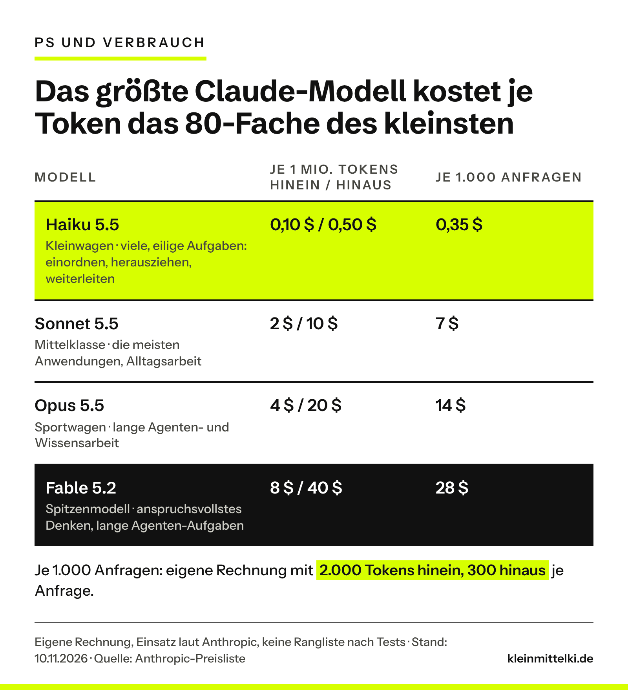
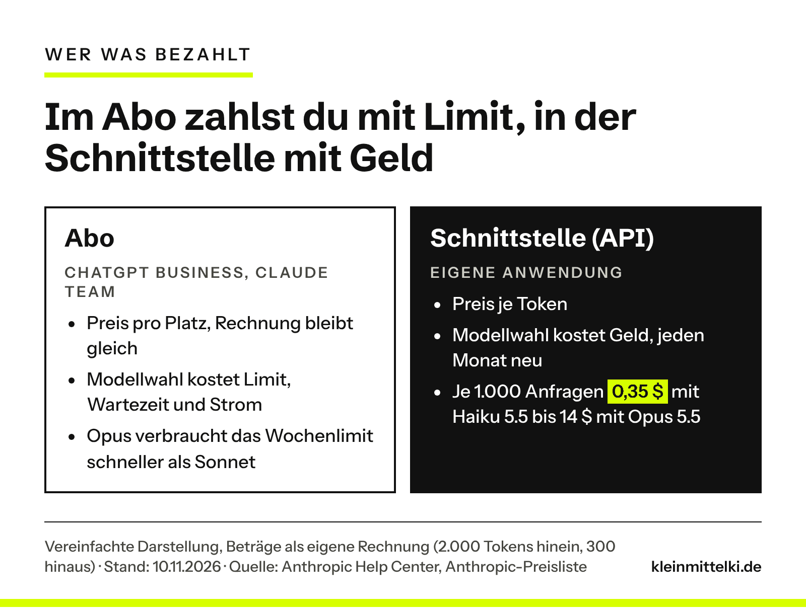
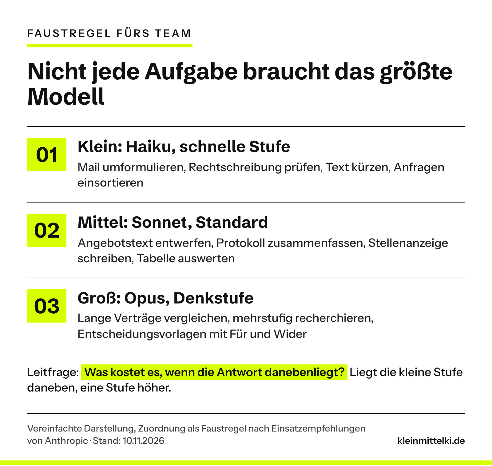
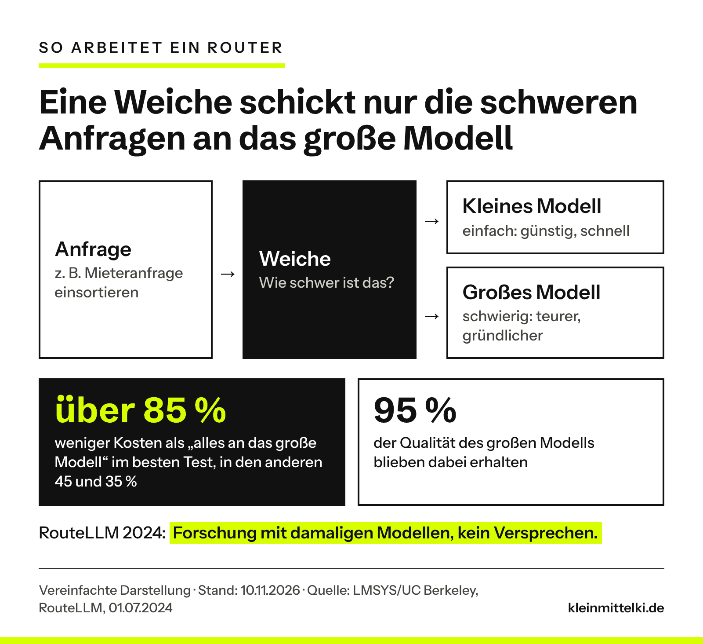

INTERN – vor Veröffentlichung entfernen: Thema und Bild „Kanonen auf Spatzen“ sind deine Idee (Chat 10.11.2026), ebenso die zwei Wege (Faustregel fürs Team, Technik davor). Eine eigene Einschätzung von dir liegt noch nicht vor. Deshalb steht im Schlussabschnitt ein Platzhalter [TILL: …] statt einer Ich-Passage; im ganzen Text gibt es sonst keine Ich-Form. Redaktionelle Vorschläge, bitte ersetzen oder freigeben: die Einstiegsszene (Ingenieurbüro mit 40 Leuten, Terminbestätigung), die Zuordnung der Beispielaufgaben zu den drei Stufen (angelehnt an Anthropics Einsatzempfehlungen und an deinen Modelle-Beitrag vom 08.10.), das Beispiel Hausverwaltung mit Kundenanfragen über die Schnittstelle, die fünf Schritte unter „Zum Ausprobieren“ samt Beispiel-Prompt und der Gedanke zum Mitnehmen. Die Preise je 1.000 Anfragen sind eine eigene Rechnung aus der offiziellen Preisliste mit einer angenommenen Anfrage von 2.000 Tokens hinein und 300 hinaus; die Annahme steht im Text. Dass viele Betriebe überdimensioniert arbeiten, ist nicht durch Nutzungsdaten belegt und deshalb als Beobachtung formuliert. Zweiter Platzhalter: Bitte in deinem ChatGPT-Business-Konto prüfen, wie die automatische Auswahl heute heißt. Nach Prüfrunde 1 geändert: Die Aussage „Opus verbraucht das Wochenlimit schneller als Sonnet“ ist gestrichen (Quelle nicht mehr erreichbar); belegt ist nur, dass Fable das Limit schneller verbraucht und auf Standard-Team-Plätzen nur über Zusatzguthaben läuft.

Dienstagmorgen in einem Ingenieurbüro mit 40 Leuten. Die Assistenz der Geschäftsführung lässt sich eine Terminbestätigung an einen Bauherrn freundlicher formulieren. Drei Sätze, nichts Schwieriges. Im Firmenkonto ist das stärkste Modell eingestellt, also rechnet das stärkste Modell. Es ist, als würde man mit dem Sportwagen zum Bäcker fahren, um zwei Brötchen zu holen.

Dieser Beitrag richtet sich an Betriebe, die schon dabei sind: Betriebe mit 10 bis 150 Leuten, die ihrem Team ChatGPT Business oder Claude Team gegeben haben. Wer seinem Team ein solches Werkzeug gibt, lässt oft jede Aufgabe über dasselbe Modell laufen, egal ob Rechtschreibung oder Vertragsprüfung. Das Bild vom Auto kennst du vielleicht aus dem Beitrag [ChatGPT ist nicht das KI-Modell](https://www.kleinmittelki.de/chatgpt-claude-gemini-ki-modelle-erklaert/): Das Produkt ist das Fahrzeug, das Modell ist der Motor. Heute geht es um PS und Verbrauch.

```html
<div class="kmk-kurz" style="border:2px solid #111;border-left:10px solid #D7FF00;padding:18px 22px;margin:28px 0;background:#fff;color:#111"><p style="margin:0 0 12px;font-weight:700;font-size:13px;letter-spacing:3px;text-transform:uppercase;line-height:1.3">Das Wichtigste in 30 Sekunden</p><ul style="margin:0;padding-left:20px;display:grid;gap:8px;line-height:1.5"><li style="margin:0">KI-Modelle gibt es in Größen wie Motoren. Bei Claude kostet das größte Modell je Token das 80-Fache des kleinsten.</li><li style="margin:0">Im Abo zahlst du pro Platz. Dort entscheidet die Modellwahl über Limits, Wartezeit und Strom, meist nicht über die Rechnung. Richtig Geld kostet sie bei eigenen Anwendungen über die Schnittstelle.</li><li style="margin:0">Billig ist nicht automatisch günstig: Ein kleines Modell, das scheitert, kostet Nacharbeit. Für schwierige Aufgaben ist das große Modell richtig.</li><li style="margin:0">Weg 1: eine Faustregel fürs Team, welche Aufgabe auf welche Stufe gehört, dazu kurze Antworten bestellen und Dateien hochladen statt hineinkopieren.</li><li style="margin:0">Weg 2: Technik, die pro Anfrage entscheidet. In ChatGPT gibt es das schon, für eigene Anwendungen heißt es Router. Vorher an echten Fällen testen.</li></ul></div>
```

## Gleiche Marke, unterschiedliche Motoren

Jeder große Anbieter hat mehrere Modelle gleichzeitig im Angebot, gestaffelt wie Motorisierungen. Bei Anthropic, dem Hersteller von Claude, heißen sie Haiku, Sonnet und Opus, darüber steht Fable als stärkstes Modell. Abgerechnet wird nach Tokens, also Textbausteinen, getrennt nach dem, was hineingeht, und dem, was das Modell schreibt. Laut [Preisliste von Anthropic](https://platform.claude.com/docs/en/about-claude/pricing) kosten eine Million Tokens (Stand: November 2026):

- **Claude Haiku 5.5:** 0,10 US-Dollar hinein, 0,50 US-Dollar hinaus (bei Anfragen bis 100.000 Tokens)
- **Claude Sonnet 5.5:** 2 US-Dollar hinein, 10 US-Dollar hinaus
- **Claude Opus 5.5:** 4 US-Dollar hinein, 20 US-Dollar hinaus
- **Claude Fable 5.2:** 8 US-Dollar hinein, 40 US-Dollar hinaus

Je Token kostet Sonnet damit das 20-Fache von Haiku, Opus das 40-Fache und Fable das 80-Fache. Anthropic beschreibt auch, wofür die Stufen gedacht sind: Haiku für viele, zeitkritische Aufgaben wie Einordnen, Herausziehen und Weiterleiten, Sonnet für Alltagsarbeit wie Texte und Datenanalyse, Opus und Fable für das anspruchsvollste Denken und lange Aufgaben, bei denen ein Agent selbstständig viele Schritte erledigt.

Was das in Euro und Cent heißt, zeigt eine einfache Rechnung. Angenommen, eine typische Anfrage schickt 2.000 Tokens hinein und bekommt 300 zurück. Dann kosten 1.000 solcher Anfragen mit Haiku 5.5 rund 0,35 US-Dollar, mit Sonnet 5.5 rund 7 US-Dollar, mit Opus 5.5 rund 14 US-Dollar und mit Fable 5.2 rund 28 US-Dollar. Die Annahme ist von uns gewählt, die Preise sind die offiziellen. Andere Längen verschieben die Beträge, nicht das Verhältnis.



In ChatGPT heißen die Stufen anders, das Prinzip ist dasselbe: Es gibt schnelle Antworten und Modelle, die länger nachdenken. Seit April 2026 lassen sich Modell und Denkstufe in ChatGPT Plus, Pro und Business laut [OpenAI](https://help.openai.com/en/articles/6825453-chatgpt-release-notes) direkt im Eingabefeld wählen.

## Was der Sprit kostet: Limits, Wartezeit und Strom

Die meisten Betriebe nutzen ChatGPT oder Claude im Abo und zahlen pro Platz. Solange niemand Zusatzguthaben nutzt, ändert sich die Rechnung am Monatsende nicht. Ausnahme: Das stärkste Claude-Modell läuft auf Standard-Plätzen im Team-Abo nur über solches Guthaben. Sonst wird der Sprit in anderer Währung bezahlt.

**Limits:** Laut [Anthropic](https://support.claude.com/en/articles/9797557-usage-limit-best-practices) hängt die Nutzungsgrenze unter anderem von der Länge der Nachrichten, der Größe der Dateien und von der Modellwahl ab. Beim stärksten Modell schreibt Anthropic es [ausdrücklich](https://support.claude.com/en/articles/15424964-claude-fable-models-on-your-plan): Wo Fable im Limit enthalten ist, etwa auf Premium-Plätzen im Team-Abo, verbraucht es das Wochenlimit schneller als die anderen Claude-Modelle. Wer morgens für jede Kleinigkeit das größte Modell nimmt, steht nachmittags bei der wichtigen Auswertung womöglich an der Grenze.

**Wartezeit:** Kleine Modelle antworten schneller. Anthropic empfiehlt Haiku ausdrücklich für die niedrigste Wartezeit. Bei vielen Anfragen am Tag merkt man das.

**Strom:** Eine Studie der Hochschule München hat 14 offene Modelle mit 1.000 Fragen auf eigener Hardware gemessen. Modelle, die vor der Antwort ausführlich „nachdenken“, erzeugten [bis zu 50-mal so viel CO₂](https://www.frontiersin.org/news/2025/06/19/ai-prompts-50-times-more-co2-emissions) wie knapp antwortende Modelle. Die Studie betrifft offene Modelle, nicht ChatGPT oder Claude selbst. Der Rat des Autors Maximilian Dauner lautet sinngemäß: knapp antworten lassen und große Modelle nur für Aufgaben nutzen, die sie wirklich brauchen.

**Geld:** Um echte Euro geht es erst, wenn ein Betrieb eine eigene Anwendung über die Schnittstelle baut, die sogenannte API. Ein Beispiel: Eine Hausverwaltung lässt eingehende Mieteranfragen automatisch einsortieren, also Schaden, Nebenkosten oder Kündigung. Kommen viele solcher Anfragen zusammen, macht der Unterschied zwischen 0,35 und 14 US-Dollar je 1.000 Anfragen aus der Rechnung oben einen echten Posten.



## Billig ist nicht immer günstig

Bevor jetzt jemand alles auf das kleinste Modell umstellt: Der Rat in der [Hersteller-Doku](https://platform.claude.com/docs/en/about-claude/models/optimizing-for-cost-and-intelligence) lautet, Modelle nach den Kosten je erledigter Aufgabe zu vergleichen, nicht nach dem Preis je Token. Ein günstiges Modell, das scheitert, kostet den Versuch, die Wiederholung und die Folgen. In einem Betrieb heißt das: die Zeit des Mitarbeiters, der nacharbeitet, oder im schlechtesten Fall den Fehler im Angebot.

Anthropics eigene Messungen zeigen beide Seiten. In einem Test mit schwierigen Prüfungsfragen beantwortete Haiku 5.5 85 Prozent richtig, Opus 5.5 und Sonnet 5.5 je 91 Prozent. Je richtiger Antwort kostete Haiku etwa ein Zwanzigstel von Opus. Ob sich das lohnt, hängt davon ab, was eine falsche Antwort in deinem Ablauf anrichtet.

Umgekehrt ist das große Modell nicht automatisch teurer pro Ergebnis. In einem Programmier-Test löste Opus 5.5 auf niedriger Denkstufe etwa so viele Aufgaben wie Sonnet 5.5 auf Standardstufe, für etwa 7 Prozent mehr je gelöster Aufgabe. Und das stärkste Modell bringt nicht immer mehr: In einem Recherche-Test kostete Fable 5.2 das 4,3-Fache von Sonnet 5.5, ohne messbar besseres Ergebnis. Anthropic nennt den Denkaufwand innerhalb eines Modells deshalb oft den besseren Hebel als den Wechsel des Modells.

Eine Einschränkung gehört dazu: Das alles sind Messungen des Herstellers, laut Anthropic selbst „richtungsweisend, keine Garantie“. Die Botschaft ist deshalb nicht „immer klein“, sondern: passend. Für den Vertragsvergleich, die mehrstufige Recherche oder die knifflige Kalkulation ist das große Modell richtig.

## Weg 1: Eine Faustregel fürs Team

Der einfachste Weg kostet keine Technik, nur eine Absprache. Wer im Betrieb die Lizenzen verwaltet, oft die Geschäftsführung selbst oder die Büroleitung, schreibt eine kurze Regel auf, welche Aufgabe auf welche Stufe gehört. Eine Seite reicht.

- **Klein (Haiku, schnelle Stufe):** Mail umformulieren, Rechtschreibung prüfen, Text kürzen, Betreffzeile vorschlagen, Anfragen einsortieren, Daten aus einem Text herausziehen.
- **Mittel (Sonnet, Standard):** Angebotstext entwerfen, Protokoll zusammenfassen, Stellenanzeige schreiben, Tabelle auswerten.
- **Groß (Opus, Denkstufe):** lange Verträge vergleichen, mehrstufig recherchieren, Zahlen mit vielen Abhängigkeiten auswerten, Entscheidungsvorlagen mit Für und Wider.

Liegt die kleine Stufe bei einer Aufgabe daneben, geht es eine Stufe höher. Das Ziel ist nur, dass niemand mehr aus Gewohnheit für jede Kleinigkeit das Größte nimmt.



Zwei weitere Gewohnheiten sparen unabhängig vom Modell.

**Kurze Antworten bestellen.** Anthropic hat denselben Agenten mit unterschiedlichen Vorgaben fürs Ergebnis laufen lassen. Eine Zeile kostete 0,49 US-Dollar, zwei Zeilen 0,57 US-Dollar, ein ausführliches Memo 1,40 US-Dollar, also das 2,8-Fache. Die Genauigkeit war im Rahmen der Messschwankung gleich. Frag also nach der Antwort, die du wirklich liest, nicht nach der, die gründlich aussieht.

**Dateien hochladen statt hineinkopieren.** Im selben Dokument steht ein Versuch mit 25 Fragen zu einer Tabelle mit 1.862 Zeilen. In die Anfrage kopiert, waren 7 von 25 Antworten richtig, bei 5,01 US-Dollar. Als Datei hochgeladen und per Programmcode ausgewertet, waren es 25 von 25, bei 0,40 US-Dollar, etwa einem Zwölftel. Gemessen wurde das über die Schnittstelle. Dass es in den Chat-Programmen ähnlich wirkt, ist plausibel, aber nicht gemessen.

## Weg 2: Technik, die vorher entscheidet

Der zweite Weg nimmt dem Team die Entscheidung ab: Eine Weiche schaut sich jede Anfrage an und schickt sie entweder an ein kleines oder an ein großes Modell.

In ChatGPT gibt es das bereits, die Auswahl heißt „Auto“. In den [Release Notes für Enterprise](https://help.openai.com/en/articles/10128477-chatgpt-enterprise-and-edu-release-notes) beschreibt OpenAI, dass Administratoren die automatische Weiterleitung auf ein kleineres Denkmodell lenken können. [TILL: Bitte im eigenen ChatGPT-Business-Konto prüfen, wie die automatische Auswahl dort heute heißt und ob sie voreingestellt ist; dann diesen Platzhalter löschen.] Für Betriebe, die nur das Abo nutzen, heißt das: Wer „Auto“ stehen lässt, überlässt die Wahl dem Anbieter. Wer fest das größte Modell einstellt, schaltet die Weiche ab.

Für eigene Anwendungen über die Schnittstelle heißt diese Weiche Router. Forschende der UC Berkeley haben 2024 mit [RouteLLM](https://www.lmsys.org/blog/2024-07-01-routellm) gezeigt, wie viel das bringen kann: Je nach Testaufgaben sanken die Kosten um 35 Prozent, 45 Prozent oder um über 85 Prozent gegenüber „alles an das große Modell“, bei 95 Prozent von dessen Qualität. In einem der Tests reichte es dafür, 26 Prozent der Anfragen an das große Modell zu schicken, nach zusätzlichem Training 14 Prozent. Eine Stanford-Gruppe beschrieb 2023 mit [FrugalGPT](https://arxiv.org/abs/2305.05176) die verwandte Kaskade: erst das günstige Modell fragen, nur wenn nötig das nächstgrößere, unter Laborbedingungen mit bis zu 98 Prozent Ersparnis.



Beide Zahlen stammen aus der Forschung mit Modellen und Preisen von 2023 und 2024. Sie zeigen das Prinzip, kein Versprechen. Deshalb gilt vor jedem Umbau: an echten Fällen aus dem eigenen Betrieb testen, nicht an Ranglisten. Das empfiehlt auch Anthropic. Und es lohnt sich die Frage aus dem Beitrag [Nicht jedes Problem braucht KI](https://www.kleinmittelki.de/nicht-jedes-problem-braucht-ki/): Steht das Merkmal schon im Betreff, reicht vielleicht eine Mailregel ganz ohne Modell.

Zwei Hebel für Anwendungen über die Schnittstelle gibt es außerdem. Was nicht sofort fertig sein muss, etwa das nächtliche Einsortieren von Belegen, kann über die Stapelverarbeitung laufen: Antwort meist innerhalb einer Stunde, spätestens nach 24 Stunden, dafür 50 Prozent Rabatt. Und laut Anthropic ist das Zwischenspeichern wiederkehrender Anweisungen, Prompt Caching genannt, in den eigenen Messungen meist der größte Hebel.

## Zum Ausprobieren: drei Aufgaben, zwei Stufen

```html
<div class="kmk-kurz" style="border:2px solid #111;border-left:10px solid #D7FF00;padding:18px 22px;margin:28px 0;background:#fff;color:#111"><p style="margin:0 0 12px;font-weight:700;font-size:13px;letter-spacing:3px;text-transform:uppercase;line-height:1.3">Die eigene Faustregel in einer halben Stunde</p><ol style="margin:0;padding:0;list-style:none;display:grid;gap:10px;line-height:1.5"><li style="margin:0;display:grid;grid-template-columns:30px 1fr;gap:10px;align-items:start"><span style="background:#D7FF00;font-weight:700;text-align:center;line-height:30px;height:30px">1</span><span>Such dir drei typische Aufgaben aus deinem Betrieb: eine leichte (Mail umformulieren), eine mittlere (Angebotstext), eine schwere (zwei Verträge vergleichen).</span></li><li style="margin:0;display:grid;grid-template-columns:30px 1fr;gap:10px;align-items:start"><span style="background:#D7FF00;font-weight:700;text-align:center;line-height:30px;height:30px">2</span><span>Lass jede Aufgabe einmal mit der kleinsten und einmal mit der größten Stufe laufen, die dein Abo anbietet. Gleicher Prompt, gleiche Unterlagen.</span></li><li style="margin:0;display:grid;grid-template-columns:30px 1fr;gap:10px;align-items:start"><span style="background:#D7FF00;font-weight:700;text-align:center;line-height:30px;height:30px">3</span><span>Leg die Antworten nebeneinander und frag dich nur: Welche würde ich so verschicken oder verwenden?</span></li><li style="margin:0;display:grid;grid-template-columns:30px 1fr;gap:10px;align-items:start"><span style="background:#D7FF00;font-weight:700;text-align:center;line-height:30px;height:30px">4</span><span>Wo die kleine Stufe reicht, kommt die Aufgabe in die Faustregel fürs Team. Wo nicht, bleibt sie beim großen Modell.</span></li><li style="margin:0;display:grid;grid-template-columns:30px 1fr;gap:10px;align-items:start"><span style="background:#D7FF00;font-weight:700;text-align:center;line-height:30px;height:30px">5</span><span>Wiederhole die leichte Aufgabe mit dem Zusatz unten und vergleiche, ob dir etwas fehlt.</span></li></ol></div>
```

```html
<div class="kmk-prompt"><p class="kmk-prompt__label">Beispiel-Prompt für kurze Antworten</p><p class="kmk-prompt__text">„Formuliere diese Terminbestätigung freundlicher. Antworte nur mit dem fertigen Text, höchstens drei Sätze, ohne Erklärung und ohne Alternativen.“</p></div>
```

## Was das für den Mittelstand bedeutet

Für die meisten Betriebe mit Abo geht es bei der Modellwahl nicht um die Rechnung, sondern um Limits, Wartezeit und Strom. Ausnahme ist Zusatzguthaben, etwa für das stärkste Claude-Modell. Die Faustregel aus Weg 1 ist in einer Teamrunde erledigt und kostet nichts.

Anders sieht es aus, sobald ein Betrieb eigene Abläufe über die Schnittstelle automatisiert, etwa Anfragen sortieren oder Rechnungsdaten auslesen. Dann wird die Modellwahl zu einer Kostenfrage, die sich mit jedem Monat wiederholt. Hier lohnt der Test mit echten Fällen, bevor das größte Modell fest eingebaut wird, und die Frage nach Stapelverarbeitung und Zwischenspeicher.

Und für beide gilt: Die Kanone hat ihren Platz. Wer einen langen Vertrag prüft oder eine Entscheidung vorbereitet, an der viel Geld hängt, sollte nicht am Modell sparen. Gespart wird bei den Spatzen.

[TILL: Deine Einschätzung in zwei bis drei Sätzen, Ich-Form: Welche Aufgaben lässt du selbst klein rechnen, wofür nimmst du bewusst das große Modell? Ohne diesen Absatz kann der Abschnitt auch rein sachlich bleiben; dann bitte nur den Platzhalter löschen.]

## Ein Gedanke zum Mitnehmen

Welche drei Aufgaben erledigt dein Team am häufigsten mit KI? Und weiß jeder, mit welcher Stufe?

## Quellen

Abgerufen am 10.11.2026, zuletzt geprüft am 10.11.2026

- [Anthropic, Claude-Dokumentation: Pricing (abgerufen 10.11.2026)](https://platform.claude.com/docs/en/about-claude/pricing)
- [Anthropic, Claude-Dokumentation: Choosing the right model (abgerufen 10.11.2026)](https://platform.claude.com/docs/en/about-claude/models/choosing-a-model)
- [Anthropic, Claude-Dokumentation: Optimizing for cost and intelligence (abgerufen 10.11.2026)](https://platform.claude.com/docs/en/about-claude/models/optimizing-for-cost-and-intelligence)
- [Anthropic Help Center: Usage limit best practices (abgerufen 10.11.2026)](https://support.claude.com/en/articles/9797557-usage-limit-best-practices)
- [Anthropic Help Center: Claude Fable models on your plan (abgerufen 10.11.2026)](https://support.claude.com/en/articles/15424964-claude-fable-models-on-your-plan)
- [OpenAI Help Center: ChatGPT Enterprise and Edu Release Notes (abgerufen 10.11.2026)](https://help.openai.com/en/articles/10128477-chatgpt-enterprise-and-edu-release-notes)
- [OpenAI Help Center: ChatGPT Release Notes (abgerufen 10.11.2026)](https://help.openai.com/en/articles/6825453-chatgpt-release-notes)
- [Ong, Almahairi, Wu u. a. (LMSYS/UC Berkeley): RouteLLM: An Open-Source Framework for Cost-Effective LLM Routing (01.07.2024)](https://www.lmsys.org/blog/2024-07-01-routellm)
- [Chen, Zaharia, Zou (Stanford): FrugalGPT: How to Use Large Language Models While Reducing Cost and Improving Performance (Mai 2023)](https://arxiv.org/abs/2305.05176)
- [Dauner, Socher (Hochschule München): Energy costs of communicating with AI. Frontiers in Communication 10 (Juni 2025)](https://doi.org/10.3389/fcomm.2025.1572947)
- [Frontiers: Pressemitteilung zur Studie von Dauner und Socher (19.06.2025)](https://www.frontiersin.org/news/2025/06/19/ai-prompts-50-times-more-co2-emissions)
