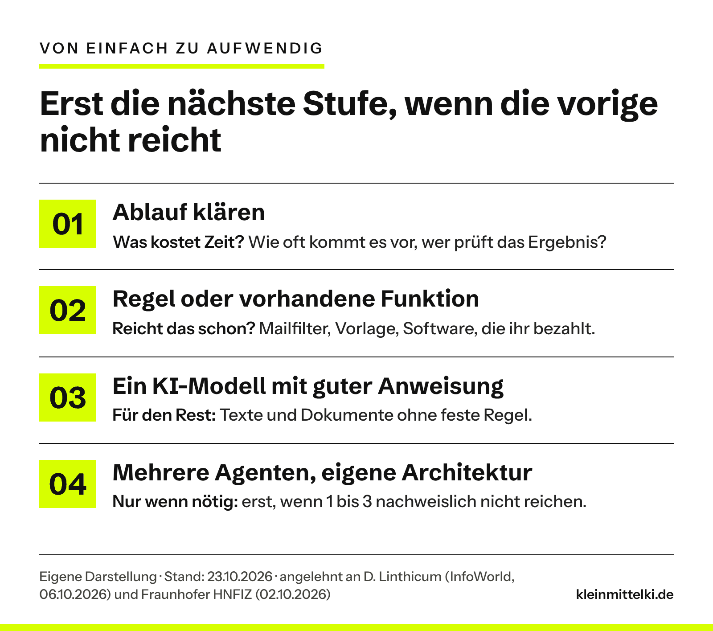

INTERN – vor Veröffentlichung entfernen: Thema ist Tills Idee (Chat 23.10.2026, Entwurf aus einem anderen Werkzeug, dort mit der Computerwoche als Quelle). Verlinkt ist jetzt das englische Original auf InfoWorld vom 06.10.2026; die Computerwoche-Fassung vom 16.10.2026 ist eine Übersetzung und steht nur im Text. Eine eigene Einschätzung von Till liegt noch nicht vor. Deshalb ist der gesamte Abschnitt „Meine Einordnung“ ein Vorschlag der Redaktion („Die Zahlen würde ich nicht …“, „Den Gedanken dahinter halte ich …“, „Linthicum ist dabei nicht pauschal …“). Ebenfalls redaktionell: das Beispiel der Hausverwaltung, die drei Prüffragen, die Stufen-Grafik (eigene Darstellung) und der Gedanke zum Mitnehmen. Gestrichen gegenüber dem Ausgangsentwurf: der Satz, große Unternehmen profitierten bei Sicherheit, Wartbarkeit und Wiederverwendung von Frameworks – das steht so nicht im Original. Bitte ersetzen oder freigeben.

## Was ist passiert?

David Linthicum, US-Experte für Cloud- und KI-Architektur, kritisiert in einem Meinungsbeitrag auf InfoWorld die vorgefertigten KI-Frameworks großer Beratungshäuser. Sein Punkt: Wer mit einer fertigen Blaupause startet, presst die eigenen Anforderungen hinein, statt die Architektur aus ihnen abzuleiten. Am Ende stünden Vektordatenbanken, wo ein Suchindex gereicht hätte, und mehrere KI-Agenten, wo ein Modell mit guten Anweisungen genügt hätte. Der Betrieb koste nach seiner direkten Erfahrung 10- bis 20-mal so viel wie nötig. Eine Studie ist das nicht. Die [Computerwoche](https://www.computerwoche.de/article/4233774/ki-frameworks-von-beratern-sollten-sie-sich-sparen.html) hat den Text am 16. Oktober auf Deutsch veröffentlicht.

## Meine Einordnung

Die Zahlen würde ich nicht wörtlich nehmen, es sind Erfahrungswerte eines einzelnen Autors. Den Gedanken dahinter halte ich trotzdem für wichtig, gerade für kleine Betriebe. Die stehen selten vor einer Berater-Blaupause, aber oft vor einem Tool, das mehr verspricht, als die Aufgabe braucht. Linthicum ist dabei nicht pauschal gegen Frameworks: Als Lernmaterial oder Checkliste hätten sie ihren Wert. Nur gehören sie ans Ende, nicht an den Anfang. Dieselbe Reihenfolge empfiehlt das Fraunhofer HNFIZ in einem Whitepaper für KMU: erst den Bedarf ermitteln, dann Ideen sammeln, priorisieren und zuletzt ein Pilotprojekt planen.

## Was bedeutet das für den Mittelstand?

Ein Beispiel aus einer Hausverwaltung mit zehn Leuten: Rechnungen und Wartungsberichte sollen automatisch beim richtigen Objekt landen. Man könnte ein KI-System bauen, das jedes Dokument liest. Steht die Objektnummer aber ohnehin im Betreff oder Dateinamen, reicht eine Regel in Mailprogramm oder Ablage. KI lohnt sich erst für den Rest: Dokumente ohne eindeutige Nummer und mit wechselndem Aufbau. Vor jeder Anschaffung helfen drei Fragen: Was genau soll besser werden? Was ist die einfachste Lösung, die reicht? Und was bringt KI zusätzlich, nach Kontrolle und laufenden Kosten? Wie das beim Firmenwissen aussieht, zeigt das [Beispiel Wissensmanagement](https://www.kleinmittelki.de/wenn-der-meister-in-rente-geht-was-ki-im-wissensmanagement-wirklich-leistet/).

## Ein Gedanke zum Mitnehmen

Die beste KI-Lösung ist manchmal eine Regel im Mailprogramm. KI lohnt sich dort, wo die einfache Lösung aufhört.

## Zum Originalartikel

:::bookmark https://www.infoworld.com/article/4230874/dont-buy-a-consultants-ai-framework.html | Don’t buy a consultant’s AI framework | InfoWorld, David Linthicum | Originalveröffentlichung vom 06.10.2026

:::bookmark https://www.hnfiz.fraunhofer.de/de/aktuelles/so-finden-kmu-den-weg-zum-passenden-ki-projekt.html | So finden KMU den Weg zum passenden KI-Projekt | Fraunhofer HNFIZ | Originalveröffentlichung vom 02.10.2026
